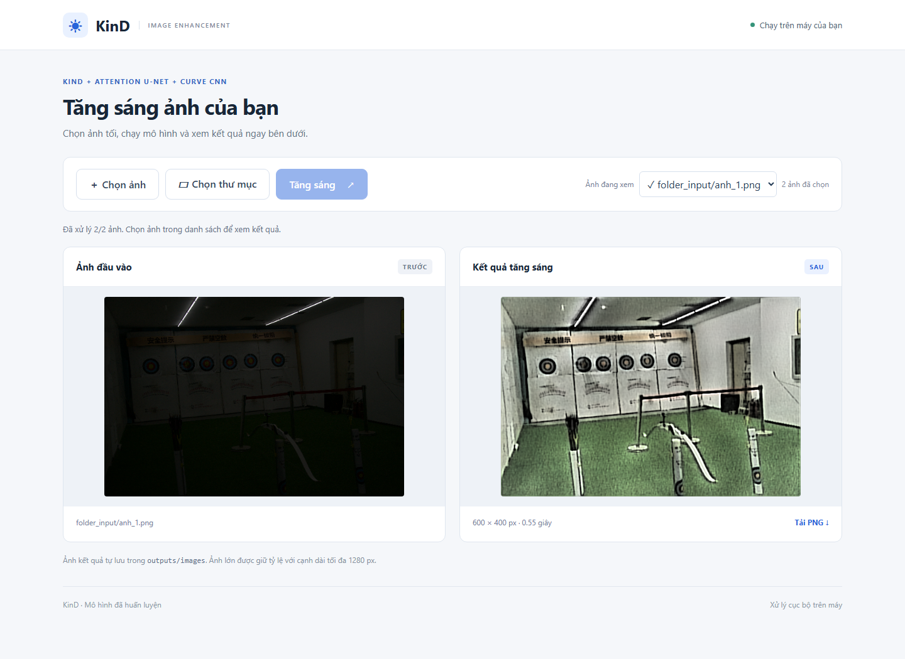

# KinD — ứng dụng tăng sáng ảnh RGB

Đưa ảnh tối vào, chạy checkpoint đã huấn luyện và nhận ảnh PNG RGB. Ứng dụng chạy cục bộ trên Windows, có preview trước/sau; ảnh gốc được giữ nguyên.

## Xem đủ 100 ảnh test

Mở **[bộ 100 ảnh test](outputs/test_100/index.html)** để xem ảnh tối → kết quả mô hình → GT, tìm theo ID và đọc chỉ số từng ảnh. Các PNG đầu ra nằm tại [outputs/test_100/images](outputs/test_100/images); [CSV 100 ảnh](outputs/test_100/per_image.csv) đi kèm. Đây là bản sao đã kiểm tra hash của kết quả đã chốt; outputs/images dành cho ảnh người dùng chạy bằng giao diện.

## Chạy ứng dụng bằng app.py

Mở **[app.py](app.py)**, chọn interpreter `.venv/Scripts/python.exe`, rồi bấm **Run Python File**. Trình duyệt mở `http://localhost:7860`.

Hoặc mở terminal tại thư mục dự án:

```powershell
.\.venv\Scripts\python.exe -B app.py
```

Chọn **Chọn ảnh** hoặc **Chọn thư mục** → **Tăng sáng** → xem trước/sau và tải PNG. Kết quả tự lưu vào `outputs/images`; metadata nằm trong `outputs/runs`, log ở `outputs/logs/web.log`. Giữ tiến trình Python khi dùng; Ctrl+C để dừng.

Đổi cổng: `app.py --port 7861`. Chạy không tự mở trình duyệt: `app.py --no-browser`. Chọn số luồng CPU: `app.py --threads 4`. Các tùy chọn dùng sau tên file trong lệnh trên. Không chạy train để xử lý ảnh mới.

Môi trường `.venv` hiện tại đã có đủ thư viện. Ứng dụng không tự tải/cài thêm. Ảnh lớn được giới hạn cạnh dài 1280 px, giữ tỷ lệ. Các lệnh xử lý ảnh bằng CLI và xuất ảnh R/L được tập trung trong [hướng dẫn sử dụng](doc/1_tong_quan/1.2_huong_dan_su_dung.md).



## Tài liệu

Bộ Markdown trong **[doc/README.md](doc/README.md)** có đúng ba nhóm:

1. Tổng quan: cấu trúc, sử dụng, lưu ý, vibe code, quy trình dự án.
2. Các kỹ thuật: architecture, business flow và C4.
3. Sản phẩm: changelog và roadmap.

[Changelog](doc/3_san_pham/3.1_changelog.md) · [Roadmap](doc/3_san_pham/3.2_roadmap.md) · [Cấu trúc dự án](doc/1_tong_quan/1.1_cau_truc_du_an.md)


[Slide thuyết trình kỹ thuật](reports/slides/Thuyet_trinh_KinD_kem_loi_doc_20261117.pptx) · [Nội dung và lời thuyết trình từng slide](doc/3_san_pham/noi_dung_tung_slide/README.md)


[Lời đọc dành cho người thuyết trình](doc/3_san_pham/KICH_BAN_NGUOI_THUYET_TRINH.md)

## Source và đầu ra

- kind_enhance/application, ui, infrastructure: use case, giao diện và đọc/ghi ảnh.
- kind_enhance/models: KinD Decomposition + Attention U-Net + Curve CNN.
- kind_enhance/inference: pipeline suy luận, calibration, RGB và luminance.
- kind_enhance/data, training/losses, evaluation: đọc dataset, huấn luyện/loss và các chỉ số.
- kind_enhance/engineering, research: điều phối thử nghiệm và tiện ích nghiên cứu.
- [Bản đồ mã nguồn](kind_enhance/README.md): trách nhiệm của từng thư mục.
- checkpoints/model_current.pt và configs/model.json: bản mô hình đã duyệt.
- outputs/images, runs, logs: ảnh, metadata và log của ứng dụng.
- tools/training, evaluation, inspection, verification, research: các công cụ tách theo vai trò.
- tests/application, inference, training, engineering, research: test theo chức năng; scripts: lệnh kiểm tra dự án.
- reports: báo cáo AWF hiện tại; experiments và results/active_model: hồ sơ bản đã chốt.

Ứng dụng ảnh mới không cần GT/dataset. Dataset LOL-v2-real có sẵn trên E chỉ phục vụ train/evaluate, giữ manifest 620 train / 69 validation / 100 test.

## Kiểm chứng

```powershell
.\.venv\Scripts\python.exe -B -m kind_enhance doctor
.\.venv\Scripts\python.exe -B -m unittest discover -s tests
.\.venv\Scripts\python.exe -B tools/verification/smoke_local_web.py
.\.venv\Scripts\python.exe -B tools/evaluation/verify_active_model.py
```

Checkpoint vẫn có SHA256 `902c100e7455dd23946f9de7891c2e4f730427149f3604f9dcdabb4e79c747d0`, tổng 2.217.963 tham số. Đợt tổ chức sản phẩm không huấn luyện hoặc đổi kiến trúc.

## Kết quả bản mô hình đã chốt

| Trung bình 100 test | Giá trị |
|---|---:|
| MLI | 0,486328 |
| CI | 0,227169 |
| E | 7,644204 |
| AG | 0,051272 |
| PSNR | 13,925115 |
| SSIM | 0,513449 |

[Báo cáo so với AWF](reports/BAO_CAO_BAN_DA_CHOT_SO_VOI_AWF.md) giữ AWF Z công bố 1,4479 và Z mô hình ước tính từ mốc gốc. AG riêng vẫn thấp hơn AWF; xuất RGB không bảo đảm màu/chất lượng GT hoàn hảo. Ảnh xám không được coi là đã khôi phục lại màu gốc. Xem báo cáo để biết cách đo và giới hạn.

[100 PNG test](experiments/ag_refinement/run_four_metric_curriculum/test/images/) · [Chỉ số từng ảnh](experiments/ag_refinement/run_four_metric_curriculum/test/per_image.csv) · [Thông tin triển khai](results/active_model/promotion.json)

## Kiểm chứng số liệu ngày 23/11/2026

Chạy lại 100/100 ảnh khớp từng pixel; bốn chỉ số tính độc lập khớp báo cáo. Đây là kiểm chứng khả năng tái lập nội bộ, chưa xác nhận tương đương chuẩn chấm cuộc thi: hàng Input đo tại dự án khác hàng Input trong đề. Test đã từng được xem kết quả trong quá trình phát triển. Chi tiết ở [audit JSON](outputs/checks/metric_audit_20261123/audit.json).

## Quản lý phiên bản

Khi bản mới được người dùng duyệt, giữ checkpoint, báo cáo mới nhất và hồ sơ/ảnh kiểm chứng tương ứng; dọn các bản đã bị thay thế. Dataset, source và tài liệu kiến trúc được giữ. Không tự thay bản đang dùng bằng ứng viên chưa duyệt.

## Lấy dự án từ GitHub

Repository có dataset giải nén và checkpoint qua Git LFS. Trên máy đã có Git LFS:

```powershell
git clone https://github.com/leduyquang-end/TangCuongAnh.git
cd TangCuongAnh
git lfs pull
```

Chuẩn bị Python và thư viện theo requirements.txt trên máy mới, chọn interpreter đó rồi chạy app.py. Máy hiện tại dùng `.venv` đã có trên E. Không đưa `.venv`, runtime, cache trình duyệt, ảnh upload cá nhân hoặc file ZIP trùng dataset vào Git. Manifest và CSV chia tập nằm trong data; code tự tìm dataset đi kèm checkout mà không sửa manifest đã khóa hash. Ảnh mới qua app không cần đọc dataset.
