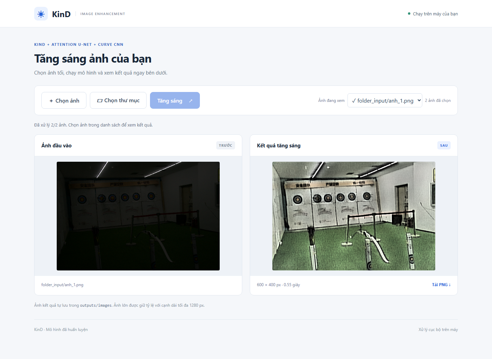

# 1.2 Hướng dẫn sử dụng

## Chạy từ file app.py

1. Mở [app.py](../../app.py) ở gốc dự án.
2. Trong trình soạn code, chọn Python `.venv/Scripts/python.exe` của dự án.
3. Bấm **Run Python File**. Trình duyệt mở `http://localhost:7860`.
4. Chọn **Chọn ảnh** (một hoặc nhiều ảnh) hoặc **Chọn thư mục**, rồi bấm **Tăng sáng**.
5. Xem ảnh trước/sau; đổi **Ảnh đang xem** nếu chọn nhiều ảnh. Nút **Tải PNG** lưu bản sao.

Lệnh tương đương, chạy tại thư mục dự án:

```powershell
.\.venv\Scripts\python.exe -B app.py
```

Giữ tiến trình Python khi dùng, nhấn Ctrl+C để dừng. Chạy lại khi server đã hoạt động sẽ mở lại giao diện hiện có. Không cần chạy huấn luyện để tăng sáng ảnh mới.

| Tùy chọn của app.py | Tác dụng |
|---|---|
| `--port 7861` | Đổi cổng nếu 7860 đang được dùng |
| `--threads 4` | Chọn số luồng CPU, mặc định 6 |
| `--no-browser` | Chạy server, tự mở địa chỉ localhost trong trình duyệt |
| `--help` | Xem các tùy chọn |

Ví dụ: `.\.venv\Scripts\python.exe -B app.py --port 7861 --threads 4`.

## Đầu vào và kết quả

Ảnh tối đa 20 MB/file; hỗ trợ PNG, JPG/JPEG, WebP, BMP, TIFF. Cạnh dài xử lý tối đa 1280 px, giữ tỷ lệ. Ảnh nhỏ giữ nguyên kích thước. EXIF orientation được áp dụng; ảnh xám/CMYK chuyển RGB; ảnh trong suốt ghép nền trắng. Ảnh lỗi được báo riêng, có thể tiếp tục với ảnh khác.

- `outputs/images`: PNG RGB đã tăng sáng; ảnh gốc giữ nguyên.
- `outputs/uploads`: dữ liệu tải lên và preview.
- `outputs/runs`: một JSON cho mỗi đường dẫn ảnh kết quả; chạy ghi đè cùng kết quả sẽ cập nhật bản ghi đó.
- `outputs/logs/web.log`: log server.

Hai lần xử lý tạo hai ảnh kết quả khác nhau là hai tác vụ riêng; không coi đó là bản ghi trùng. Không tự xóa hồ sơ đo test hoặc bản ghi huấn luyện.



## Môi trường

Dự án trên máy này ở `E:/trenlop/XuLyAnh/Do_An_Tang_Cuong_Anh`, có `.venv` Python 3.11.9, PyTorch 2.8.0+cpu, NumPy 2.2.6, Pillow 11.3.0. Không cần tải/cài thêm để chạy trên máy này. Khi chuyển máy, cần chuẩn bị Python và thư viện theo [requirements.txt](../../requirements.txt), cùng checkpoint đã duyệt. App không tự tải thư viện, dataset hoặc checkpoint.

## CLI cho xử lý ảnh và xuất thành phần

Các lệnh dưới đây là công cụ bổ sung; giao diện người dùng chạy bằng app.py.

```powershell
# Xử lý ảnh demo, tự lưu kết quả
.\.venv\Scripts\python.exe -B -m kind_enhance infer --input assets/demo/anh_toi.png

# Xuất ảnh kết quả và R/L, các bước trung gian; thư mục stages phải mới
.\.venv\Scripts\python.exe -B -m kind_enhance infer --input 'anh_toi.jpg' --output outputs/images/ket_qua.png --max-side 0 --stages outputs/stages/vi_du_moi
```

`--max-side 0` giữ kích thước gốc, có thể tốn thêm RAM. Chỉ dùng `--overwrite` khi chủ động muốn ghi đè PNG kết quả; ảnh gốc và thư mục dataset/model được bảo vệ.

## Xem và kiểm chứng 100 ảnh test

Mở [trang xem 100 ảnh](../../outputs/test_100/index.html), [thư mục ảnh](../../outputs/test_100/images) hoặc [CSV](../../outputs/test_100/per_image.csv). Bộ ảnh là bản sao có kiểm tra hash từ kết quả đã chốt. Xuất lại trang xem bằng `python -B tools/evaluation/export_test_gallery.py`.

```powershell
# Kiểm tra môi trường/checkpoint, không huấn luyện
.\.venv\Scripts\python.exe -B -m kind_enhance doctor

# Khởi động app.py thật, gửi ảnh qua HTTP và so pixel với kết quả đã chốt
.\.venv\Scripts\python.exe -B tools/verification/smoke_local_web.py

# Chạy lại 100 test để đối chiếu số liệu, không chọn tham số
.\.venv\Scripts\python.exe -B tools/verification/audit_reported_metrics.py
```

Xem [audit đã chạy](../../outputs/checks/metric_audit_20261123/audit.json) và [báo cáo AWF](../../reports/BAO_CAO_BAN_DA_CHOT_SO_VOI_AWF.md). Số liệu là của toàn pipeline gồm hậu xử lý. Chưa có mã chấm chính thức/AWF để xác nhận cùng chuẩn đo; test đã từng được xem kết quả trong quá trình phát triển.

## Khi có lỗi

| Hiện tượng | Cách xử lý |
|---|---|
| Không import được torch/PIL | Chọn interpreter `.venv/Scripts/python.exe` của dự án |
| Cổng bị ứng dụng khác sử dụng | Chạy app.py với `--port 7861` |
| Checkpoint thiếu hoặc sai hash | Kiểm tra configs/model.json và model_current.pt; không sửa hash để bỏ qua kiểm tra |
| Không đọc được ảnh | Dùng định dạng hỗ trợ và xem thông báo trên giao diện |
| Không ghi được kết quả | Kiểm tra dung lượng và quyền ghi outputs |

