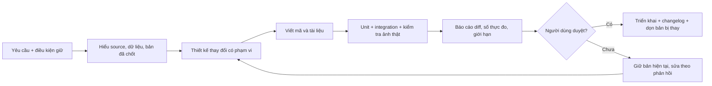

# 1.4 Quy trình vibe code

Vibe code trong dự án là vòng cộng tác có yêu cầu, bằng chứng và người duyệt. Agent hỗ trợ viết mã/kiểm tra; chủ dự án quyết định mục tiêu, chấp nhận đánh đổi và duyệt bản triển khai.



## Trước khi code

Ghi rõ use case, đầu vào/đầu ra, điều kiện chấp nhận, phần được sửa và phần phải giữ. Xác định đúng thư mục dự án, checkpoint, môi trường Python và tài liệu liên quan. Nếu thiếu thông tin quan trọng, hỏi sớm và tiếp tục phần độc lập đã rõ.

## Trong khi code

Chia lớp UI/service/model/IO rõ ràng; dùng lại pipeline được đo, tránh tạo một đường xử lý khác cho demo. Làm thay đổi nhỏ có thể xem xét, lưu source/config/hash cho run huấn luyện, kiểm tra lỗi đầu vào thực tế. Không giả lập số liệu thành kết quả thực đo và không tự thêm kiến trúc khác.

## Trước khi bàn giao

Chạy test phù hợp, mở giao diện bằng model thật, kiểm tra ảnh lưu đúng RGB và đối chiếu đầu ra checkpoint đã chốt. Kiểm tra liên kết tài liệu/entrypoint sau khi đổi folder. Nêu rõ đã làm gì, kiểm chứng bằng gì, phần nào chưa đạt. Chỉ xin duyệt khi đã có mã/kết quả cụ thể để xem.

## Mẫu yêu cầu

```text
Mục tiêu: [hành vi cần có].
Đầu vào/đầu ra: [định dạng, kích thước, thư mục].
Giữ nguyên: [kiến trúc, checkpoint, dataset hoặc API].
Chấp nhận khi: [test hoặc hành vi quan sát được].
Giới hạn: [CPU/RAM, không tải thêm, không tune test].
Bàn giao: source, hướng dẫn chạy, báo cáo kiểm chứng và giới hạn.
```

Ví dụ tính năng ảnh hiện tại: chọn JPEG tối → chạy checkpoint đã duyệt → preview → PNG RGB, không ghi đè ảnh gốc; test EXIF/alpha, model được nạp một lần và GUI vẫn phản hồi khi xử lý.
