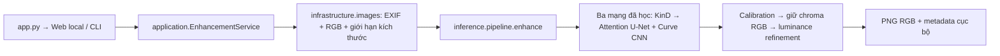
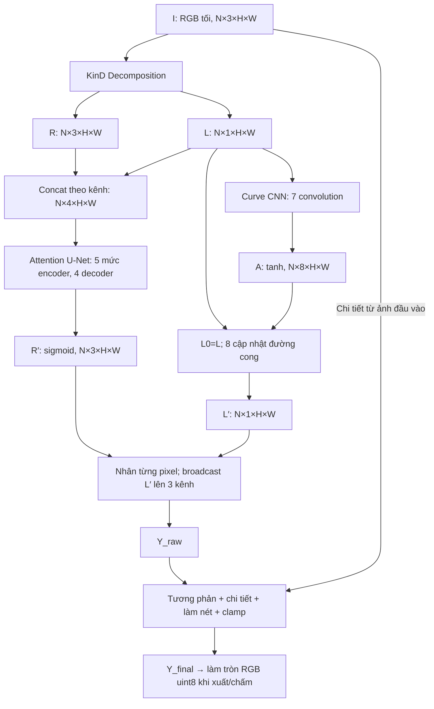
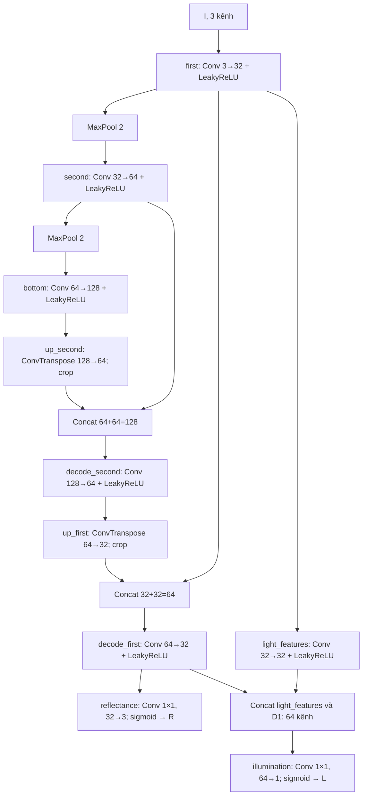
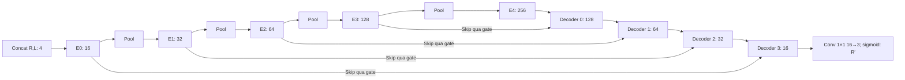
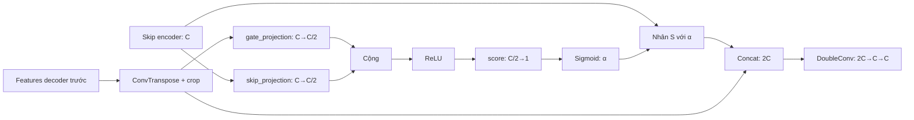
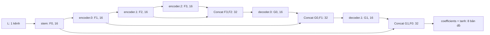

# Kiến trúc chi tiết mô hình KinD + Attention U-Net + Curve CNN

## Kiến trúc sản phẩm 1.0.0



`app.py` khởi động `kind_enhance/ui/local_web.py`, phục vụ HTML/CSS/JS trong `ui/web`. Trình duyệt gửi ảnh qua HTTP tới `EnhancementService` ở `application/enhancement.py`; service cache model và tuần tự hóa suy luận bằng lock. IO ở `infrastructure/images.py`. `load_inference_model` kiểm hash và nạp checkpoint; ảnh mới không cần dataset/GT. `load_model` bổ sung kiểm manifest cho train/evaluate. Cách chạy được tập trung trong [hướng dẫn sử dụng](../1_tong_quan/1.2_huong_dan_su_dung.md).

Ảnh mới được đưa vào mạng ba kênh float [0,1]; model eval + inference_mode. Các phần sau mô tả đúng mạng/hậu xử lý đang dùng. Lớp ứng dụng không thêm tầng, không thay trọng số hoặc scalar của pipeline. Model có 2.217.963 tham số; giao diện và IO không có tham số học.

Mặc định web/CLI giới hạn cạnh dài 1280, giữ tỷ lệ. Với ảnh 600×400 của benchmark không có resize. Màu cuối dùng RGB preservation blend=1/gain=0,5 như cấu hình đã duyệt; chroma lấy từ input đã lọc, luminance đến từ pipeline học. Xuất RGB không được diễn giải là khôi phục màu GT hoàn hảo.

[Business flow](2.2_business_flow.md) · [C4](2.3_mo_hinh_c4.md) · [Hướng dẫn sử dụng](../1_tong_quan/1.2_huong_dan_su_dung.md)


Tài liệu mô tả **đúng cài đặt đang triển khai**, gồm cấu trúc tầng, kết nối, kích thước, phép toán không có tham số, hiệu chỉnh đầu ra và đường truyền gradient. Không suy ra thêm các tầng từ tên bài báo hoặc từ một biến thể U-Net khác.

Checkpoint mặc định: `checkpoints/model_current.pt`; cấu hình [model.json](../../configs/model.json). Tổng **2.217.963 tham số**, **52 tầng Conv2d/ConvTranspose2d**. Con số và shape được kiểm tra trực tiếp trên checkpoint bằng [công cụ trace](../../tools/inspection/inspect_model_architecture.py).

## Mục lục

1. Phạm vi, ký hiệu và giao diện
2. Sơ đồ toàn bộ luồng dữ liệu
3. Quy tắc kích thước, convolution và skip
4. KinD Decomposition: từng tầng và hai đầu ra
5. Attention U-Net: encoder, decoder và attention gate
6. Curve CNN: bảy convolution và tám bước đường cong
7. Tái hợp và hiệu chỉnh ngoài mạng
8. Khác biệt giữa suy luận và huấn luyện; đường gradient
9. Số tham số, khởi tạo và giới hạn diễn giải
10. Trace kiểm chứng và ánh xạ mã nguồn

[Phụ lục đầy đủ 52 tầng](phu_luc/52_tang.md) cung cấp tên module, k/s/p, bias, input/output và số tham số từng tầng. [C4](2.3_mo_hinh_c4.md) mô tả hệ thống phần mềm, còn tài liệu này tập trung mạng và phép toán ảnh.

## 1. Phạm vi, ký hiệu và giao diện

| Ký hiệu | Ý nghĩa | Shape |
|---|---|---|
| I | Ảnh RGB thiếu sáng, float trong [0,1] | N×3×H×W |
| R | Phản xạ do decomposition dự đoán | N×3×H×W |
| L | Chiếu sáng do decomposition dự đoán | N×1×H×W |
| R′ | Phản xạ do restoration dự đoán | N×3×H×W |
| A | Tám bản đồ hệ số đường cong | N×8×H×W |
| L′ | Chiếu sáng sau tám bước đường cong | N×1×H×W |
| Y_raw | Tái hợp R′×L′, đầu ra trực tiếp của model | N×3×H×W |
| Y_final | Ảnh sau hiệu chỉnh, dùng khi lưu/chấm điểm | N×3×H×W |
| GT | Ảnh đủ sáng ghép cặp, chỉ cần khi huấn luyện/đánh giá tham chiếu | N×3×H×W |

Shape dùng **NCHW**. Ảnh LOL-v2 có chiều rộng 600, cao 400 nên tensor đầy đủ là `1×3×400×600`, không phải `1×3×600×400`. Batch train đã dùng là `8×3×80×80`. Memory format `channels_last` trong runtime chỉ thay bố trí bộ nhớ, không thay thứ tự kích thước logic NCHW.

Đọc RGB uint8 → chuyển float và chia 255; không có chuẩn hóa ImageNet mean/std. Khi xuất ảnh, clamp [0,1], nhân 255, làm tròn và chuyển uint8. Đây là bước ngoài forward học được.

Giao diện [enhancement.py](../../kind_enhance/models/enhancement.py):

```python
R, L = model.decomposition(I)
R_prime = model.restoration(R, L)
L_prime, A = model.adjustment(L)
Y_raw = R_prime * L_prime
# model.enhance(R, L) trả (Y_raw, R_prime, L_prime, A)
# model(I) chỉ trả Y_raw
# inference.pipeline.enhance(model, I, config) trả Y_final
```

Ba mô-đun có bộ trọng số riêng. Restoration và adjustment cùng nhận thông tin decomposition nhưng không chia sẻ convolution với nhau. Suy luận một ảnh chỉ cần I; không cần GT.

## 2. Sơ đồ toàn bộ luồng dữ liệu



Hai nhánh R′ và L′ độc lập về phép tính sau decomposition; mã hiện tại gọi restoration rồi adjustment tuần tự, không triển khai song song hai nhánh ở mức tiến trình.

## 3. Quy tắc kích thước và phép nối

- Conv 3×3: stride 1, padding 1; Conv 1×1: stride 1, padding 0. Tất cả có dilation 1, groups 1.
- MaxPool 2×2: stride 2, `ceil_mode=True`; `H_next=ceil(H/2)`, `W_next=ceil(W/2)`.
- ConvTranspose 2×2: stride 2, padding 0, output_padding 0; tạo H/W gấp đôi trước cắt.
- Sau upsampling: `up[..., :skip_H, :skip_W]`; chỉ cắt dư phía dưới/phải. Không nội suy bilinear và không pad thêm để khớp skip.
- Concat thực hiện ở `dim=1`; cộng số kênh, giữ nguyên N/H/W. Các phép cộng và nhân được giải thích riêng, không dùng thay cho concat.

| Mức pooling | Ảnh H×W=400×600 | Crop 80×80 | Trường hợp lẻ 81×79 |
|---|---|---|---|
| 0 | 400×600 | 80×80 | 81×79 |
| 1 | 200×300 | 40×40 | 41×40 |
| 2 | 100×150 | 20×20 | 21×20 |
| 3 | 50×75 | 10×10 | 11×10 |
| 4 | 25×38 | 5×5 | 6×5 |

Decomposition chỉ xuống mức 2; Attention U-Net xuống mức 4. Ví dụ decoder sâu nhất của U-Net trên ảnh đầy đủ tạo `50×76`, sau đó cắt về `50×75`. Việc ghi đơn giản W/16 sẽ sai vì 600 không chia hết cho 16.

## 4. KinD Decomposition Net

**235.876 tham số; 10 tầng có trọng số.** Nguồn: [decomposition.py](../../kind_enhance/models/decomposition.py). Mạng học biểu diễn sao cho `I ≈ R×L`; R và L là ước lượng của mạng, không có bảo đảm chúng là các đại lượng vật lý duy nhất.

### 4.1 Sơ đồ kết nối đầy đủ



### 4.2 Từng tầng với ảnh 400×600

N được lược khỏi shape ở bảng dưới; các Conv thường là 3×3 nếu không ghi khác. LeakyReLU có slope 0.2.

| Tên module | Đầu vào C×H×W | Đầu ra sau activation/crop | Tham số |
|---|---|---|---:|
| first | 3×400×600 | 32×400×600 | 896 |
| second, sau pool | 32×200×300 | 64×200×300 | 18.496 |
| bottom, sau pool | 64×100×150 | 128×100×150 | 73.856 |
| up_second, ConvTranspose | 128×100×150 | 64×200×300 | 32.768 |
| decode_second, sau concat | 128×200×300 | 64×200×300 | 73.792 |
| up_first, ConvTranspose | 64×200×300 | 32×400×600 | 8.192 |
| decode_first, sau concat | 64×400×600 | 32×400×600 | 18.464 |
| reflectance, Conv 1×1 | 32×400×600 | 3×400×600, sigmoid | 99 |
| light_features, từ first | 32×400×600 | 32×400×600 | 9.248 |
| illumination, Conv 1×1 sau concat | 64×400×600 | 1×400×600, sigmoid | 65 |

Hai ConvTranspose của decomposition có `bias=False`; các convolution còn lại có bias. Đầu chiếu sáng nhận cả đặc trưng nông F1 qua `light_features` và đặc trưng decoder cuối D1. Không lấy L bằng trung bình RGB hoặc phép max cố định.

## 5. Attention U-Net khôi phục phản xạ

**1.963.407 tham số; 35 tầng có trọng số.** Nguồn: [attention_unet.py](../../kind_enhance/models/attention_unet.py).

### 5.1 Encoder và skip

Đầu vào `concat(R,L)` có 4 kênh. `DoubleConv(a,b)` là `Conv3×3(a,b) → LeakyReLU(0.2) → Conv3×3(b,b) → LeakyReLU(0.2)`. Mọi conv đều có bias. Không có BatchNorm, LayerNorm hay dropout trong cài đặt này.

| Module | Hai convolution | Output C×H×W, ảnh đầy đủ | Output C×H×W, crop | Vai trò |
|---|---|---|---|---|
| encoders.0 | 4→16→16 | 16×400×600 | 16×80×80 | Skip S0, rồi pool |
| encoders.1 | 16→32→32 | 32×200×300 | 32×40×40 | Skip S1, rồi pool |
| encoders.2 | 32→64→64 | 64×100×150 | 64×20×20 | Skip S2, rồi pool |
| encoders.3 | 64→128→128 | 128×50×75 | 128×10×10 | Skip S3, rồi pool |
| encoders.4 | 128→256→256 | 256×25×38 | 256×5×5 | Bottleneck, không pool tiếp |



### 5.2 Chi tiết từng decoder

| Module | ConvTranspose | Output trước crop | Skip/output sau crop | Kênh trong gate | Concat → DoubleConv |
|---|---|---|---|---:|---|
| decoders.0 | 256→128 | 128×50×76 | 128×50×75 | 64 | 256→128→128 |
| decoders.1 | 128→64 | 64×100×150 | 64×100×150 | 32 | 128→64→64 |
| decoders.2 | 64→32 | 32×200×300 | 32×200×300 | 16 | 64→32→32 |
| decoders.3 | 32→16 | 16×400×600 | 16×400×600 | 8 | 32→16→16 |

Đầu `head` là Conv 1×1, 16→3, sau đó sigmoid. Mạng dự đoán trực tiếp R′; không có phép cộng residual `R + correction` ở đầu ra.

### 5.3 Attention gate: mọi nhánh và công thức

Gọi U là đặc trưng đã upsample/crop, S là skip, cả hai có C kênh. Ba projection đều là Conv 1×1 có bias:

```text
Qs = Ws * S + bs          # C → C/2
Qg = Wg * U + bg          # C → C/2
Q  = ReLU(Qs + Qg)
α  = sigmoid(Wψ * Q + bψ) # C/2 → 1
S_att = S ⊙ α            # broadcast α trên C kênh
F_out = DoubleConv(concat(U, S_att))
```



α có shape `N×1×H_skip×W_skip`: một mặt nạ không gian, dùng chung cho các kênh tại mỗi vị trí. Đây là additive gating trên skip; không có Q/K/V, multi-head attention, softmax theo token hoặc positional encoding. Gate chỉ điều tiết skip; nhánh U vẫn được đưa trực tiếp vào concat.

## 6. Curve CNN điều chỉnh chiếu sáng

**18.680 tham số; 7 tầng Conv2d.** Nguồn: [curve_cnn.py](../../kind_enhance/models/curve_cnn.py). Tất cả kernel 3×3, stride 1, padding 1, có bias; không pooling/upsampling. Mọi tensor đặc trưng giữ H×W của L.

### 6.1 Đúng thứ tự skip trong mã

| Module | Phép tính | Kênh | Tham số |
|---|---|---|---:|
| stem | F0 = ReLU(conv(L)) | 1→16 | 160 |
| encoder.0 | F1 = ReLU(conv(F0)) | 16→16 | 2.320 |
| encoder.1 | F2 = ReLU(conv(F1)) | 16→16 | 2.320 |
| encoder.2 | F3 = ReLU(conv(F2)) | 16→16 | 2.320 |
| decoder.0 | G0 = ReLU(conv(concat(F3,F2))) | 32→16 | 4.624 |
| decoder.1 | G1 = ReLU(conv(concat(G0,F1))) | 32→16 | 4.624 |
| coefficients | A = tanh(conv(concat(G1,F0))) | 32→8 | 2.312 |

Trong vòng lặp encoder, mã lưu `skips` **trước** mỗi convolution, nên danh sách là `[F0,F1,F2]`, không phải `[F1,F2,F3]`.



### 6.2 Tám bước biến đổi ánh sáng

Tách A thành tám tensor aₜ shape `N×1×H×W`. Các hệ số được dự đoán **một lần từ L ban đầu**, không chạy lại CNN sau mỗi bước.

```text
L0 = L
L1 = L0 + a0 * L0 * (1-L0)
L2 = L1 + a1 * L1 * (1-L1)
...
L8 = L7 + a7 * L7 * (1-L7)
L′ = L8
```

aₜ>0 tăng sáng tại vị trí đó; aₜ<0 giảm sáng; aₜ=0 giữ nguyên. Với Lₜ trong [0,1] và aₜ trong [-1,1], phép biến đổi này giữ giá trị trong [0,1] theo công thức. Không cần clamp ở giữa tám bước trong mã.

Khi xem a cố định, đạo hàm theo L là `1 + a*(1−2L)`; theo a là `L*(1−L)`. Autograd còn truyền gradient qua nhánh CNN dự đoán a từ L. Vì vậy cả bộ hệ số lẫn decomposition đều có thể được cập nhật.

## 7. Tái hợp và hiệu chỉnh đầu ra

### 7.1 Tái hợp

`Y_raw[n,c,h,w] = R′[n,c,h,w] * L′[n,0,h,w]`. Không có convolution hoặc tham số mới ở phép nhân. Đạo hàm cục bộ theo R′ là L′; gradient theo L′ cộng đóng góp từ cả ba kênh RGB.

### 7.2 Định nghĩa đầy đủ của hiệu chỉnh

Nguồn: [kind_enhance/inference/calibration.py](../../kind_enhance/inference/calibration.py). Đặt `g(X)=0.299*X_R+0.587*X_G+0.114*X_B`, trả một kênh. `B_k` là average pooling kernel k, stride 1, padding k//2, `count_include_pad=False`; biên không tính các pixel padding vào mẫu số.

```text
C = g(Y_raw) − mean_spatial(g(Y_raw))
J = B3(g(I^0.4))
d = J − B7(J)
D = sign(d) * clamp(abs(d) − 0.004, 0, 0.08)

dx = sai phân g(Y_raw) theo chiều ngang, thêm 0 ở cột cuối
dy = sai phân g(Y_raw) theo chiều dọc, thêm 0 ở hàng cuối
w = clamp(sqrt(dx² + dy²) / 0.05, 0, 1)
S = (Y_raw − B3(Y_raw)) * w

Y_final = clamp(Y_raw + 0.08*C + 0.25*D + 1.4*S, 0, 1)
```

C và D có một kênh, broadcast lên RGB. S có ba kênh sau khi nhân với w một kênh. Gamma 0.4 chỉ dùng lấy đặc trưng chi tiết từ ảnh đầu vào, không thay Curve CNN và không trực tiếp áp lên toàn bộ ảnh đầu ra. Các hệ số 1.08/0.25/1.4 là cấu hình cố định, không phải trọng số mạng học được.

`Y_raw` và `Y_final` là hai đầu ra khác nhau. Khi báo cáo kết quả 100 test hiện có, ảnh chấm là **Y_final đã lượng tử hóa uint8**. Dùng trực tiếp `model(I)` sẽ chưa có bước hiệu chỉnh này.

### 7.3 Giữ màu và hiệu chỉnh luminance sau calibration

Sau biểu thức calibration ở trên, pipeline thực hiện giữ màu RGB blend=1,0/gain=0,5 bằng input đã lọc separable 15×15; chroma được scale vào gamut mà không đổi luminance. Tiếp theo tăng tương phản luminance 1,02 quanh mean và lift 0,007; giữ hướng chroma và chặn gamut. Y_final dùng đo/lưu là kết quả sau đủ ba bước. Với blend=1, chroma cuối đến từ input đã lọc, mạng cung cấp luminance. Mã: kind_enhance/inference/color_preservation.py và luminance_refinement.py. Các bước không có tham số học, không thay cấu trúc ba mạng.

## 8. Đồ thị huấn luyện và đường gradient

Lượt cuối đóng băng decomposition, cập nhật restoration và adjustment (1.982.087 tham số). Teacher đóng băng, GT/target detach. Loss gồm L1 RGB, SSIM, biên có hướng ở hai tỷ lệ với GT hỗ trợ, thiếu hụt AG mục tiêu 0,05 rồi 0,1, phạt tăng gradient ngoài hỗ trợ, neo mean/CI/soft entropy và luminance teacher. Xem [công thức đầy đủ](phu_luc/huan_luyen_va_loss.md).

Autograd → loss.backward → clip norm 5 → Adam. Giai đoạn 1 LR 6e-5; giai đoạn 2 LR 4e-5, mỗi giai đoạn 3 epoch, batch 8, crop 80, seed 827. stable_calibration_features tránh đạo hàm không hữu hạn ở norm bằng 0. Chọn bằng validation; test không có backward hay cập nhật trọng số. Pipeline triển khai không mang theo teacher.

## 9. Tham số, khởi tạo và phạm vi cài đặt

| Mô-đun | Số tầng có tham số | Số tham số |
|---|---:|---:|
| KinD Decomposition | 10 | 235.876 |
| Attention U-Net | 35 | 1.963.407 |
| Curve CNN | 7 | 18.680 |
| Pooling, activation, concat, multiply, hiệu chỉnh | 0 | 0 |
| **Tổng** | **52** | **2.217.963** |

Conv2d có số tham số `C_out*(C_in/groups)*kH*kW + bias`; ConvTranspose2d là `C_in*(C_out/groups)*kH*kW + bias`, với bias có C_out phần tử nếu bật. Các activation không có tham số học. Chỉ riêng trọng số float32 chiếm khoảng 8,46 MiB; đây không phải tổng RAM huấn luyện hoặc kích thước checkpoint chứa metadata/optimizer.

Khởi tạo khi tạo mạng mới: decomposition gọi Xavier uniform và bias zero; đầu coefficients của Curve CNN dùng normal std=0.001, bias zero; các lớp còn lại giữ khởi tạo mặc định của lớp PyTorch. Khi suy luận/tinh chỉnh từ checkpoint, trọng số đã lưu ghi đè các giá trị khởi tạo này.

Không có BatchNorm, dropout, Transformer, mô hình ngôn ngữ hoặc thuật toán AWF bên trong mô hình. AWF chỉ là mốc báo cáo. Engineering loop là bộ điều phối huấn luyện/tìm cấu hình ngoài mô hình; policy v2 không thêm tầng hoặc thay số kênh. Tài liệu mô tả cài đặt địa phương, không khẳng định nó trùng từng dòng với mã KinD/Attention U-Net của tác giả bài báo.

R, L và các ảnh trung gian là đầu ra có thể kiểm tra, không nên mặc định xem chúng là nhãn vật lý chính xác. Kết quả Z cao hơn một baseline không bảo đảm màu sắc, từng chỉ số hay chất lượng cảm nhận đều tốt hơn.

## 10. Kiểm chứng từ mã và đường dẫn sử dụng

Công cụ [inspect_model_architecture.py](../../tools/inspection/inspect_model_architecture.py) đã nạp checkpoint đang triển khai, gắn hook vào cả 52 tầng, chạy input tổng hợp cho ba trường hợp:

| Trường hợp | Input | Output raw/final đã xác minh |
|---|---|---|
| Ảnh đầy đủ | 1×3×400×600 | 1×3×400×600 |
| Batch crop train | 8×3×80×80 | 8×3×80×80 |
| Kích thước lẻ | 1×3×81×79 | 1×3×81×79 |

Các đầu ra đều hữu hạn; tổng tham số từng tầng khớp tổng module; hash checkpoint, cấu hình và mã mạng giữ nguyên. Đây là kiểm chứng shape trên input tổng hợp, không phải lần huấn luyện hoặc benchmark ảnh mới. Các trường hợp đã đo không thay thế kiểm thử cho mọi kích thước đầu vào có thể có.

- [Phụ lục 52 tầng, gồm shape trước crop](phu_luc/52_tang.md).
- [Trace JSON có hash nguồn và cấu hình](phu_luc/model_trace.json).
- [Lớp tổng hợp mô hình](../../kind_enhance/models/enhancement.py).
- [Đọc dữ liệu và chuẩn hóa](../../kind_enhance/data/paired_dataset.py).
- [Suy luận và hiệu chỉnh](../../kind_enhance/inference/pipeline.py).
- [C4 hệ thống](2.3_mo_hinh_c4.md).

Chạy lại công cụ từ thư mục dự án bằng Python hiện có: `python -B tools/inspection/inspect_model_architecture.py`. Công cụ chỉ tạo lại phụ lục/trace, không train và không đọc ảnh trong dataset.
