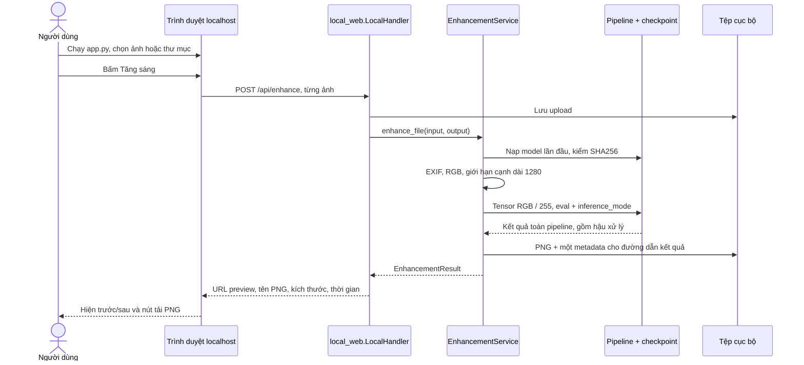

# 2.2 Business flow

## Luồng xử lý ảnh qua app.py

Trình duyệt gửi ảnh lần lượt; service dùng lock để bảo vệ model cache và suy luận. Ảnh mới không cần GT, không tính loss, không cập nhật trọng số. Checkpoint không đúng hash thì dừng xử lý.

## Quy tắc đầu ra và lỗi

Ảnh gốc giữ nguyên. Kết quả tự có tên riêng trong outputs/images. Mỗi đường dẫn kết quả có một JSON trong outputs/runs; nếu người dùng chủ động ghi đè cùng kết quả qua CLI thì metadata được cập nhật. Hai ảnh kết quả khác nhau vẫn có hai bản ghi riêng.

Ảnh lỗi nhận thông báo qua HTTP; frontend có thể tiếp tục ảnh khác. Server ghi lỗi vào outputs/logs/web.log. Ctrl+C dừng server; ảnh và metadata đã lưu vẫn còn trên ổ đĩa. Giới hạn tệp, định dạng và lệnh chạy nằm trong [hướng dẫn sử dụng](../1_tong_quan/1.2_huong_dan_su_dung.md).

## Luồng nghiên cứu và đánh giá

Train → chọn checkpoint/tham số bằng validation → khóa cấu hình → đánh giá test → báo cáo → người dùng duyệt bản triển khai. Công cụ train/evaluate tách khỏi giao diện; tools/research không tự thay model_current.pt.

Dự án từng xem kết quả test trong quá trình phát triển nên không mô tả test là kiểm định độc lập hoàn toàn. Số liệu tái lập trong dự án chưa bảo đảm tương đương chuẩn chấm cuộc thi. Chi tiết ở [báo cáo AWF](../../reports/BAO_CAO_BAN_DA_CHOT_SO_VOI_AWF.md).

RGB cuối dùng luminance từ pipeline học và chroma từ input được làm trơn; không đồng nghĩa khôi phục màu GT hoàn hảo. Xem [kiến trúc](2.1_architecture.md).
