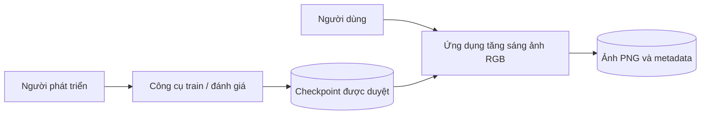
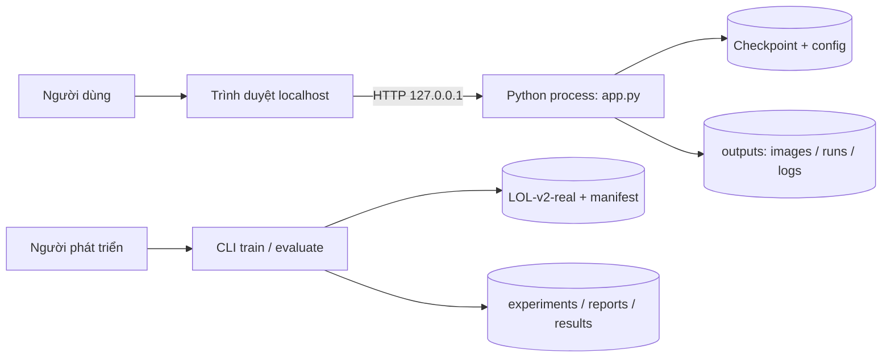
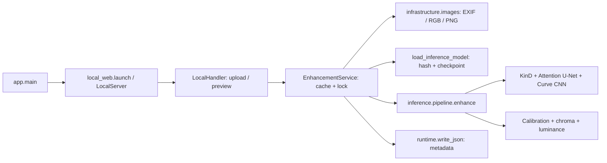
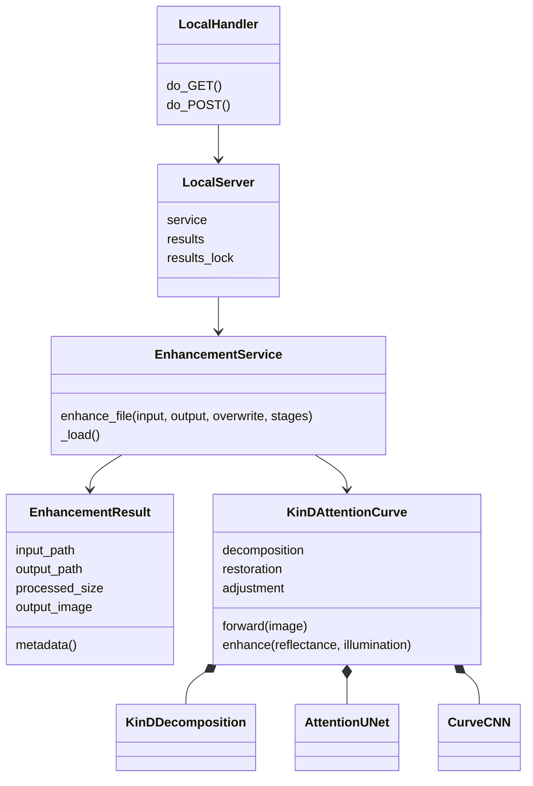

# 2.3 Các mô hình C4

## C1 — System context

Người dùng đưa ảnh tối vào để nhận ảnh tăng sáng. Công cụ nghiên cứu dùng dataset riêng; ảnh mới không cần GT.

## C2 — Containers

Container ở đây là tiến trình hoặc nơi lưu dữ liệu. Một trình duyệt và một tiến trình Python local; không cần dịch vụ ngoài hoặc database. Mặc định server chỉ lắng nghe loopback cổng 7860.

## C3 — Components trong server

Giao diện không sửa trọng số. Service chuẩn bị tensor và gọi pipeline chung; pipeline gồm mô hình cùng các bước hiệu chỉnh đã duyệt.

## C4 — Code

## Deployment và source

Máy Windows, Python của dự án và checkpoint/config cục bộ; CPU mặc định 6 luồng. App không tự cài thư viện hoặc tải dữ liệu. Cách chạy tại [hướng dẫn sử dụng](../1_tong_quan/1.2_huong_dan_su_dung.md).

- [Điểm vào app.py](../../app.py)
- [HTTP server](../../kind_enhance/ui/local_web.py)
- [Service](../../kind_enhance/application/enhancement.py)
- [IO ảnh](../../kind_enhance/infrastructure/images.py)
- [Pipeline](../../kind_enhance/inference/pipeline.py)
- [Chi tiết ba mạng](2.1_architecture.md)
- [Business flow](2.2_business_flow.md)
