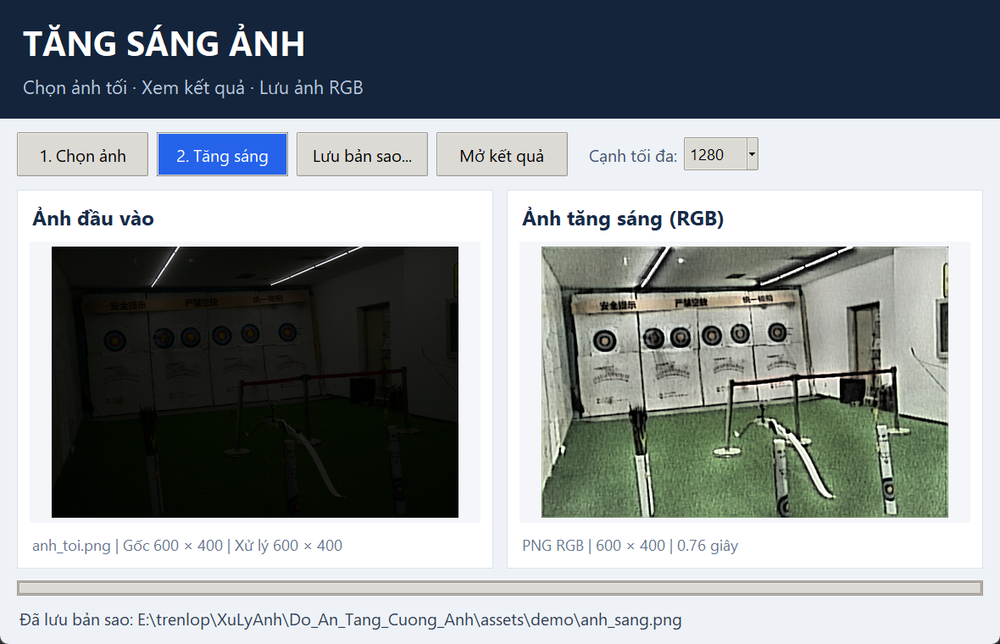

# 3.1 Changelog

## Gom cách chạy và dọn trùng — 23/11/2026

- Dùng app.py làm file chạy giao diện; hỗ trợ --port, --threads và --no-browser.
- Bỏ LOCALHOST.cmd, CHAY_LOCAL.cmd, start_app.cmd và scripts/start_app.ps1; các mục lịch sử bên dưới mô tả phiên bản cũ.
- Gom hướng dẫn chạy vào mục 1.2; cập nhật architecture, business flow và C4 theo web local.
- Mỗi đường dẫn ảnh kết quả có một metadata ổn định; dọn các bản ghi cũ bị thay thế cho cùng đường dẫn và log có nội dung trùng byte.
- Smoke test khởi động app.py bằng tiến trình thật rồi gửi ảnh qua HTTP, đối chiếu PNG với kết quả đã chốt.

## Web local — 14/11/2026

- Thêm CHAY_LOCAL.cmd: mở localhost trên trình duyệt.
- Chọn một/nhiều ảnh hoặc thư mục; xử lý lần lượt, đổi ảnh để xem trước/sau, tải PNG.
- Dùng lại checkpoint và EnhancementService; không cài thư viện mới.
- Đã kiểm tra HTTP thật và trình duyệt Edge: chọn file, chọn folder hai ảnh, chuyển kết quả, link tải PNG và giao diện màn hình nhỏ. PNG khớp bản đã chốt; 64 test cũ tiếp tục đạt.
- Screenshot: [giao diện web](assets/giao_dien_web_local.png).

## Tổ chức lại mã nguồn — 13/11/2026

- Di chuyển 26 module cấp gốc vào inference, data, training/losses, evaluation, infrastructure và research.
- Chia 18 file test theo application, inference, training, engineering và research.
- Cập nhật import, đường dẫn hash/snapshot và tài liệu cho cấu trúc mới; giữ lệnh mở ứng dụng hiện có.
- Giữ nguyên các file kiến trúc mạng, checkpoint, cấu hình và manifest dataset.
- Xem cây thư mục trong [1.1 Cấu trúc dự án](../1_tong_quan/1.1_cau_truc_du_an.md).

## 1.0.0 — 13/11/2026

### Thêm

- Ứng dụng desktop chọn ảnh tối, preview trước/sau, suy luận nền và tự lưu PNG RGB.
- Lưu bản sao, mở thư mục kết quả, lựa chọn cạnh tối đa 800/1280/1600.
- Service dùng chung cho GUI/CLI, cache model và metadata từng lần xử lý.
- Đọc ảnh EXIF/alpha/grayscale/CMYK, bảo vệ ảnh gốc và các thư mục dữ liệu/model.
- Lệnh doctor, launcher start_app.cmd và script kiểm tra dự án.
- Ảnh demo và screenshot giao diện chạy bằng checkpoint thật.
- pyproject.toml, package ứng dụng/UI/IO và nhóm tools theo chức năng.

### Tổ chức lại

- Thư mục doc dùng Markdown theo Tổng quan / Các kỹ thuật / Sản phẩm, giữ chi tiết kiến trúc/52 tầng.
- Công cụ chia training, evaluation, inspection, verification và research; cập nhật import/đường dẫn.
- README tập trung cách chạy sản phẩm và dẫn tới báo cáo AWF hiện tại.

### Giữ nguyên

- Kiến trúc KinD Decomposition + Attention U-Net + Curve CNN, 2.217.963 tham số.
- Checkpoint SHA256 `902c100e7455dd23946f9de7891c2e4f730427149f3604f9dcdabb4e79c747d0`.
- Công thức/pipeline của bản đã duyệt; không huấn luyện thêm trong đợt tổ chức sản phẩm.
- Dataset/split 620 train / 69 validation / 100 test và các hồ sơ đánh giá gốc.
- Báo cáo AWF giữ Z AWF công bố 1,4479; Z mô hình ước tính từ mốc năm ban đầu.

### Kiểm chứng

64 unit/regression tests đã qua sau khi thêm chức năng. GUI smoke test đã chạy với model thật, ảnh RGB lưu ra khớp ảnh đã báo cáo của checkpoint được duyệt. Kết quả kiểm tra sản phẩm và hồi quy 100 ảnh được ghi tại outputs/checks và results/active_model.

## Bản mô hình nền trước khi tổ chức sản phẩm

Bản đã chốt có trung bình 100 test: MLI 0,486328; CI 0,227169; E 7,644204; AG 0,051272; PSNR 13,925115; SSIM 0,513449. Chất lượng và giới hạn ở [báo cáo AWF](../../reports/BAO_CAO_BAN_DA_CHOT_SO_VOI_AWF.md). Phiên bản ứng dụng 1.0.0 không được mô tả là đã cải thiện các chỉ số này.
