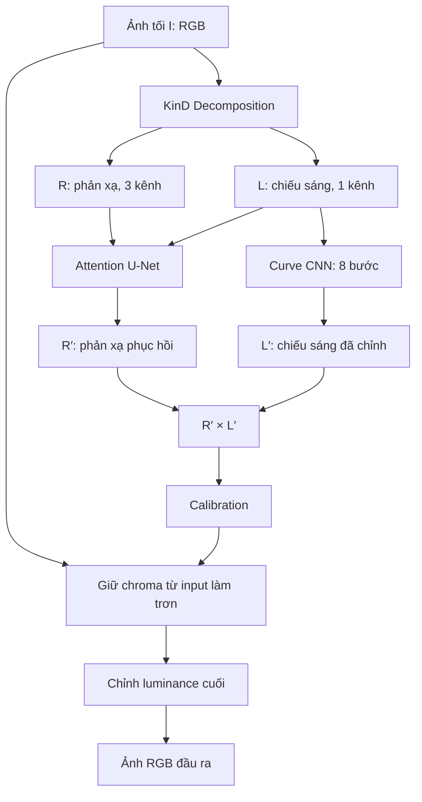
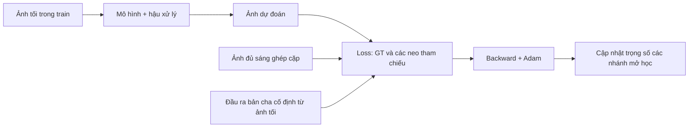

# BÁO CÁO MÔ HÌNH TĂNG CƯỜNG ẢNH THIẾU SÁNG

**KinD Decomposition + Attention U-Net + Curve CNN trên LOL-v2-real**

Ngày cập nhật: **24/11/2026**. Báo cáo giải thích mô hình đang dùng trong app.py, lý do chọn từng thành phần, vấn đề cần giải quyết và các điểm yếu. Kết quả lấy từ hồ sơ thực nghiệm và lần kiểm chứng ngày 23/11/2026. Lần viết báo cáo này không huấn luyện hoặc thay mô hình.

## Mục lục

1. Bài toán và mục tiêu.
2. Tổng quan các mô hình và kiến trúc.
3. KinD Decomposition.
4. Attention U-Net.
5. Curve CNN.
6. Tái tạo ảnh, hiệu chỉnh và giữ màu.
7. Nhánh ảnh sáng chuẩn, huấn luyện và loss.
8. Dataset và cách đánh giá.
9. Kết quả thực đo, đối chiếu AWF và đánh đổi.
10. Điểm yếu và mức độ chứng minh.
11. Tài nguyên và cách chạy.
12. Hướng cải thiện và kết luận.
13. Tài liệu tham khảo, bằng chứng.

## 1. Bài toán và mục tiêu

Ảnh thiếu sáng có thể đồng thời bị tối, nhiễu, lệch màu và khó nhận ra chi tiết. Tăng tất cả pixel cùng một mức có thể làm vùng sáng bị cháy và làm nhiễu dễ thấy hơn.

Dự án nhận một ảnh RGB tối, tạo ảnh RGB dễ quan sát hơn bằng mô hình học từ các cặp ảnh tối–sáng, và cung cấp giao diện local để sử dụng. Đánh giá cần xem cả mức sáng, tương phản, phân bố mức xám, gradient và độ giống ảnh chuẩn.

Báo cáo phân biệt **lý do thiết kế**, **kết quả thực đo** và **điều chưa chứng minh**. Chọn kiến trúc có cơ sở không có nghĩa đã chứng minh nó tốt nhất. Dự án chưa có thí nghiệm bỏ/thay từng thành phần trong cùng điều kiện, gọi là ablation study, để đo riêng lợi ích của attention, Curve CNN hoặc hậu xử lý.

## 2. Tổng quan các mô hình và kiến trúc

### 2.1. Dùng những thành phần nào?

| Thành phần | Vai trò và đầu vào → đầu ra | Lý do chọn | Điểm yếu chính |
|---|---|---|---|
| KinD Decomposition | RGB → phản xạ R ba kênh và chiếu sáng L một kênh | Chia phục hồi nội dung và chỉnh ánh sáng thành hai nhiệm vụ | Sai số phân tách ảnh hưởng cả hai nhánh sau |
| Attention U-Net | Thay Reflectance Restoration; nhận R và L → R′ RGB | Kết hợp ngữ cảnh nhiều mức, skip connection và cổng điều tiết đặc trưng | Tốn phần lớn tham số; có thể giữ nhiễu hoặc bỏ chi tiết |
| Curve CNN | Thay Illumination Adjustment; nhận L → L′ qua tám bước đường cong | Điều chỉnh sáng theo vị trí bằng một mạng nhỏ | Không tự khôi phục nội dung đã mất; không trực tiếp sửa màu RGB |
| Calibration, giữ chroma, chỉnh luminance | Hậu xử lý ảnh mạng và input → RGB cuối | Điều chỉnh mức tương phản, chi tiết và giữ thông tin màu | Hệ số cố định; có thể tăng nhiễu, clipping hoặc giữ sai màu |

Ba mạng đầu có tham số học. Hậu xử lý hiện tại không có bộ trọng số riêng được optimizer học. Kết quả đã công bố là kết quả của **toàn pipeline**, không chỉ ba mạng.

### 2.2. Sơ đồ suy luận



Hai nhánh nhận **cùng bản đồ L** từ decomposition; Attention U-Net còn nhận R. R và L không giống nhau. R là phản xạ dự đoán, không phải riêng kênh đỏ trong RGB. L mô tả phân bố chiếu sáng dự đoán.

### 2.3. Quy mô triển khai

| Mạng | Số tham số | Tỷ lệ |
|---|---:|---:|
| KinD Decomposition | 235.876 | 10,63% |
| Attention U-Net | 1.963.407 | 88,52% |
| Curve CNN | 18.680 | 0,84% |
| **Tổng** | **2.217.963** | **100%** |

Trace hiện tại đếm **52 lớp Conv2d/ConvTranspose2d**, không tính pooling, activation, nối đặc trưng hoặc phép nhân như convolution. Xem [kiến trúc đầy đủ](../2_cac_ky_thuat/2.1_architecture.md) và [phụ lục 52 tầng](../2_cac_ky_thuat/phu_luc/52_tang.md).

## 3. KinD Decomposition

### 3.1. Cơ sở và lý do chọn

KinD chia ảnh thành phản xạ và chiếu sáng để xử lý suy giảm nội dung và điều chỉnh sáng ở hai phần riêng. Dự án kế thừa cách chia nhiệm vụ này, giữ mô-đun decomposition đang triển khai. Nguồn: [KinD](https://arxiv.org/abs/1905.04161).

Biểu diễn sử dụng:

\[
I\approx R\odot L.
\]

L một kênh được nhân lên từng kênh của R. Có thể hình dung R chứa thông tin bề mặt và màu dự đoán, còn L chứa phân bố ánh sáng. Đây là biểu diễn do mạng ước lượng, không phải phép đo trực tiếp vật liệu hay nguồn sáng ngoài đời.

### 3.2. Cài đặt và vấn đề cần giải quyết

Mạng nhận tensor `N×3×H×W`. Encoder có 32 → 64 → 128 kênh, giảm kích thước bằng max pooling. Decoder dùng transposed convolution và nối skip để phục hồi độ phân giải. Hai head sigmoid tạo R ba kênh và L một kênh trong [0,1].

Phân tách tạo vị trí rõ ràng để nhánh Curve CNN chỉnh sáng mà không phải dự đoán lại toàn bộ nội dung RGB. Nhánh phục hồi nhận R cùng L để có thông tin vùng nào thiếu sáng hơn.

Ở giai đoạn học decomposition, loss ràng buộc tái tạo cả ảnh tối và ảnh đủ sáng, sự tương đồng phản xạ giữa hai ảnh và độ trơn chiếu sáng. Ảnh sáng không cung cấp nhãn R/L vật lý đo sẵn; mạng cũng phải suy ra R/L của ảnh sáng.

### 3.3. Điểm yếu

Phép phân tách không có nghiệm duy nhất: nhiều cặp R/L có thể tái tạo gần cùng một ảnh. Các loss hướng dẫn mạng về biểu diễn hữu ích nhưng không bảo đảm tách đúng hoàn toàn theo vật lý. Nhiễu hoặc cấu trúc có thể bị phân bổ sai vào R/L và truyền sai số xuống hai nhánh sau.

Trong fine-tune cuối, decomposition được **đóng băng**. Điều này giữ nền phân tách ổn định nhưng cũng không sửa sai số của nó trong đợt đó. Giữ mô-đun hiện tại không đồng nghĩa dùng nguyên toàn bộ mô hình/trọng số KinD công bố.

Mã: [decomposition.py](../../kind_enhance/models/decomposition.py).

## 4. Attention U-Net

### 4.1. Cơ sở và lý do chọn thay nhánh restoration

U-Net kết hợp đường thu nhỏ lấy ngữ cảnh với đường mở rộng và đặc trưng skip. Attention U-Net thêm cổng điều tiết đặc trưng. Hai công trình gốc hướng tới ảnh y sinh; dự án chuyển ý tưởng kiến trúc sang hồi quy phản xạ RGB. Nguồn: [U-Net](https://arxiv.org/abs/1505.04597), [Attention U-Net](https://arxiv.org/abs/1804.03999).

Lý do thiết kế của dự án: phục hồi vùng tối cần cả ngữ cảnh rộng và chi tiết cục bộ. Skip giúp truyền chi tiết, còn attention cho phép điều tiết thông tin từ skip. Đây là cơ sở lựa chọn, chưa phải kết luận Attention U-Net đã được chứng minh tốt hơn U-Net thường trong dự án.

### 4.2. Đầu vào và encoder–decoder

Ghép R ba kênh với L một kênh tạo tensor bốn kênh. L hỗ trợ nhận biết điều kiện chiếu sáng cho tác vụ phục hồi; không phải một ảnh RGB khác.

Encoder có năm mức 16 → 32 → 64 → 128 → 256 kênh. Mỗi mức gồm hai convolution 3×3 và LeakyReLU. Bốn decoder lần lượt tăng kích thước, nhận skip được điều tiết và hợp nhất đặc trưng. Head convolution 1×1 với sigmoid xuất R′ ba kênh.

### 4.3. Attention hoạt động ra sao?

Gọi x là đặc trưng skip, g là đặc trưng decoder đã tăng kích thước. Hai đặc trưng được chiếu bằng convolution 1×1, cộng lại, qua ReLU, convolution 1×1 và sigmoid tạo mặt nạ α:

\[
\alpha=\sigma\big(\psi(\operatorname{ReLU}(W_xx+W_gg))\big),\qquad x_{gate}=\alpha\odot x.
\]

Code nối `x_gate` với đặc trưng decoder rồi dùng hai convolution để hợp nhất. Mặt nạ có một kênh tại mỗi vị trí không gian, nhân lên các kênh skip. Đây là attention gate cục bộ, không phải self-attention toàn ảnh của Transformer.

Có thể hiểu α như mức cho phép đặc trưng đi qua. Nó được học từ loss, không biết sẵn đâu chắc chắn là nhiễu và đâu là chi tiết thật.

### 4.4. Giải quyết vấn đề gì và yếu ở đâu?

Nhánh này nhằm phục hồi phản xạ suy giảm, giữ biên và hạn chế chuyển đặc trưng không phù hợp từ encoder sang decoder. Kết hợp nhiều mức giúp sử dụng ngữ cảnh khi xử lý vùng tối. Lợi ích riêng của attention chưa được tách bằng ablation.

Attention có thể giữ nhầm nhiễu giống biên hoặc làm yếu kết cấu nhỏ. Pooling có thể làm mất chi tiết mảnh. Nhánh này chiếm phần lớn tham số và bộ nhớ feature map.

Sigmoid chỉ giới hạn giá trị trong [0,1], không bảo đảm đúng màu hoặc khớp GT. Thông tin đã mất do thiếu sáng không thể được khôi phục chắc chắn. Ngoài ra, ở cấu hình `blend=1`, chroma cuối lấy từ input nên R′ không quyết định toàn bộ màu cuối cùng.

Mã: [attention_unet.py](../../kind_enhance/models/attention_unet.py).

## 5. Curve CNN

### 5.1. Cơ sở và lý do chọn thay nhánh chỉnh sáng

Zero-DCE đưa ra cách học đường cong để điều chỉnh ảnh theo nội dung. Dự án sử dụng ý tưởng đường cong lặp cho bản đồ L và học trong hệ thống có ảnh tham chiếu. Đây không phải bản tái lập toàn bộ Zero-DCE hoặc cách học không tham chiếu của bài gốc. Nguồn: [Zero-DCE](https://arxiv.org/abs/2001.06826).

Lý do chọn là điều chỉnh sáng theo vị trí bằng mạng nhỏ, thay cho một hệ số nhân hoặc gamma duy nhất cho toàn ảnh. Tám bước là cấu hình đang dùng; chưa có thí nghiệm chứng minh tốt hơn bốn hoặc mười sáu bước.

### 5.2. Cài đặt và hoạt động

Mạng có bảy convolution 3×3, width 16. Sáu lớp đầu tạo/hợp nhất đặc trưng bằng ReLU và các kết nối nối đặc trưng; lớp cuối dùng Tanh tạo tám bản đồ hệ số `N×8×H×W`. Không pooling nên giữ độ phân giải L.

Đặt L₀=L, thực hiện:

\[
L_{t+1}=L_t+a_t\odot L_t\odot(1-L_t),\quad t=0,\ldots,7,\quad a_t\in[-1,1].
\]

Hệ số dương nâng sáng, hệ số âm hạ sáng; mỗi vị trí và mỗi bước có thể nhận hệ số khác. L′ là kết quả sau tám bước.

### 5.3. Giải quyết vấn đề gì và điểm yếu?

Một cảnh có thể có cả góc tối và đèn sáng. Đường cong theo vị trí cho phép điều chỉnh khác nhau theo vùng. Với đầu vào [0,1] và hệ số bị giới hạn, phép ánh xạ giữ miền giá trị. Cơ chế biến đổi cũng rõ ràng để phân tích.

Nhánh này không phải bộ khử nhiễu hoặc mạng tự sinh chi tiết. Hai đầu mút 0 và 1 là điểm giữ nguyên của phép đường cong. Giữ miền giá trị không bảo đảm phơi sáng tự nhiên. Vì chỉ xử lý L một kênh, nó không trực tiếp sửa cân bằng trắng hoặc màu RGB.

Nếu L sai, đường cong có thể chỉnh sai vùng. Số tham số nhỏ không đủ chứng minh tốc độ tốt hơn mọi phương pháp; chưa có benchmark riêng từng nhánh.

Mã: [curve_cnn.py](../../kind_enhance/models/curve_cnn.py).

## 6. Tái tạo ảnh, hiệu chỉnh và giữ màu

### 6.1. Ghép hai nhánh

Đầu ra trực tiếp của ba mạng là:

\[
Y_{raw}=R'\odot L'.
\]

L′ một kênh được broadcast lên ba kênh R′. Ảnh được lưu/chấm điểm còn qua các bước dưới đây, nên không thể gán toàn bộ số đo cho riêng ba mạng.

### 6.2. Calibration: ba hệ số trong slide

Các số **contrast=1,08; detail=0,25; sharpen=1,4** nằm trong [model.json](../../configs/model.json). Đây là tham số cấu hình cố định, không phải trọng số `nn.Parameter` được Adam cập nhật hoặc giá trị mạng tự chọn cho từng ảnh.

Hàm hiện tại có dạng:

\[
Y_{cal}=\operatorname{clip}(Y_{raw}+0,08C+0,25D+1,4S,0,1).
\]

| Thành phần | Cách lấy trong code | Vấn đề muốn xử lý | Điểm yếu |
|---|---|---|---|
| C: tương phản | Luminance dự đoán trừ trung bình toàn ảnh | Tăng phân biệt sáng–tối | Có thể quá tương phản hoặc tăng clipping |
| D: chi tiết input | Nâng sáng input bằng lũy thừa 0,4; lấy luminance, lọc 3×3, trừ bản làm trơn 7×7 và áp ngưỡng | Bổ sung chi tiết cục bộ | Có thể đưa nhiễu còn sót từ input vào kết quả |
| S: làm sắc nét | Dự đoán trừ blur 3×3, nhân trọng số theo biên | Làm rõ đường biên | Có thể tăng nhiễu, viền giả hoặc làm ảnh gắt |

Các hệ số không tương đương phần trăm tăng CI/AG. App không đối chiếu với ảnh đủ sáng để tìm lại ba số này. Hồ sơ cho thấy chúng được kế thừa và giữ cố định trong fine-tune cuối; chưa đủ lịch sử để chứng minh đây là bộ tối ưu hoặc đã được tìm bằng một thí nghiệm kiểm soát đầy đủ.

Mã: [calibration.py](../../kind_enhance/inference/calibration.py).

### 6.3. Chroma là gì và vì sao làm trơn?

**Luminance là thông tin độ sáng; chroma là thông tin màu còn lại sau khi tách độ sáng.** Chiếc áo đỏ trong ảnh tối có luminance thấp nhưng vẫn mang tín hiệu đỏ. Chroma không phải thao tác làm trơn; làm trơn là cách xử lý nhằm giảm biến động màu cục bộ.

Code dùng luminance xấp xỉ `0,299R + 0,587G + 0,114B` và phần chênh lệch RGB với luminance để biểu diễn màu. Không gọi đây là phép chuyển đổi đầy đủ sang hệ màu YCbCr/Lab tiêu chuẩn.

Input được làm trơn bằng average pooling 1×15 rồi 15×1, tương đương lọc trung bình 15×15 ở vùng trong ảnh. Code lấy phần màu tương đối từ input làm trơn, điều chỉnh theo luminance kết quả và `gain=0,5`, rồi ghép lại. Có bước giảm biên độ màu khi cần để giữ RGB trong miền hợp lệ.

**Với `blend=1`, chroma ở bước ghép màu lấy hoàn toàn từ nguồn input đã làm trơn theo công thức này; không pha chroma dự đoán vào.** R′ vẫn góp vào ảnh tái tạo và luminance. Vì vậy đầu ra ba kênh sigmoid không có nghĩa mô hình quyết định hoàn toàn màu cuối.

Mục đích là giữ sắc màu input và giảm nhiễu màu. Điểm yếu là có thể giữ cả ám màu sai, làm nhòe biên màu hoặc làm màu kém bão hòa. Không bảo đảm màu khớp GT.

Mã: [color_preservation.py](../../kind_enhance/inference/color_preservation.py).

### 6.4. Chỉnh luminance cuối

Cấu hình còn có `contrast=1,02` và `lift=0,007` trong `luminance_refinement`. Code điều chỉnh độ lệch luminance so với trung bình và nâng sáng nhỏ, rồi ghép chroma trong miền RGB hợp lệ. Đây là bước khác với Calibration.

Mục đích là điều tiết mức sáng/tương phản cuối. Điểm yếu là tiếp tục phụ thuộc hệ số cố định, có thể không hợp mọi ảnh. Cần đo raw và các phiên bản có/không hậu xử lý để xác định đóng góp thực tế.

Mã: [luminance.py](../../kind_enhance/inference/luminance.py).

## 7. Nhánh ảnh sáng chuẩn, huấn luyện và loss

### 7.1. Có đưa ảnh sáng chuẩn vào không?

**Có, khi huấn luyện.** Ảnh đủ sáng GT và ảnh tối là một cặp cùng cảnh; GT dùng làm đích để tính loss. GT không phải ảnh được đưa vào tạo đầu ra khi app xử lý ảnh mới.



Ở loss cơ bản, decomposition cũng xử lý GT để tạo R_GT/L_GT làm tham chiếu nội bộ. Các thành phần này do mạng suy ra, không phải nhãn phản xạ/chiếu sáng vật lý. Trong fine-tune cuối, ảnh sau hậu xử lý được so với GT về RGB, cấu trúc và gradient; đầu ra bản cha còn làm neo giữ hành vi đã có.

### 7.2. Thành phần nào được học?

| Thành phần | Fine-tune cuối | Khi chạy app.py |
|---|---|---|
| Decomposition | Đóng băng trọng số | Suy luận |
| Attention U-Net | Cập nhật trọng số | Suy luận |
| Curve CNN | Cập nhật trọng số | Suy luận |
| Teacher/bản cha | Cố định, tạo neo tính loss | Không cần cho ảnh mới |
| Hệ số Calibration, màu, luminance | Cố định, nằm trong đường tạo ảnh tính loss | Dùng lại cấu hình |
| GT | Cần để tính loss có tham chiếu | Không cần |

Gradient đi qua hậu xử lý để cập nhật mạng không biến các hằng số cấu hình thành tham số optimizer học. Loss dùng phiên bản tính đặc trưng calibration có xử lý đạo hàm ổn định tại gradient bằng không.

### 7.3. Loss fine-tune cuối gồm những gì?

Công thức trong `four_metrics.py`:

\[
\begin{aligned}
\mathcal L={}&\mathcal L_{RGB}+(1-SSIM)+10\mathcal L_{edge}+80\mathcal L_{AG}\\
&+12\mathcal L_{flat}+100\mathcal L_{brightness}+8\mathcal L_{contrast}\\
&+4\mathcal L_{entropy}+0,2\mathcal L_{anchor}.
\end{aligned}
\]

| Loss | Tham chiếu và mục đích | Điểm yếu |
|---|---|---|
| RGB L1, SSIM | So GT, giữ pixel và cấu trúc | Có thể xung đột với mục tiêu đẩy gradient |
| Signed edge | Dùng hướng gradient GT và bản cha, tăng biên được hỗ trợ | Có thể bỏ sót biên teacher chưa nhận ra |
| AG có hỗ trợ | Tăng gradient trong vùng có cơ sở từ GT/bản cha | Không bảo đảm mọi gradient tăng đều là chi tiết thật |
| Flat noise | Phạt gradient tăng thêm ở vùng ít hỗ trợ | Ràng buộc mềm, không bảo đảm khử nhiễu |
| Brightness | Neo luminance theo bản cha trong khoảng mục tiêu | Mục tiêu patch không bảo đảm ánh sáng toàn ảnh tự nhiên |
| Contrast | Khuyến khích tăng độ lệch chuẩn trong giới hạn | Có thể làm ảnh gắt hoặc clipping |
| Entropy | Hạn chế suy giảm soft entropy so với bản cha | Nhiễu cũng có thể tăng entropy |
| Anchor | Hạn chế luminance rời quá xa bản cha | Có thể giữ lại hạn chế của bản cha |

Entropy trong loss là xấp xỉ khả vi với 64 bins; chỉ số E báo cáo là histogram 256 mức trên uint8. Không coi hai phép tính là trùng hoàn toàn.

Teacher là checkpoint bản cha, không phải mô hình ngôn ngữ; không chạy trong app. Hiện không có mô hình ngôn ngữ nhỏ trong pipeline.

### 7.4. Quy trình fine-tune và chọn checkpoint

| Chặng | Epoch | Learning rate | AG target trong loss | Edge gain |
|---|---:|---:|---:|---:|
| ag_005 | 3 | 0,00006 | 0,05 | 2,5 |
| ag_010 | 3 | 0,00004 | 0,10 | 4,0 |

Dùng Adam, batch 8, patch 80×80, seed 827; crop và augmentation quay/lật từ train. Engine thực hiện `zero_grad → forward → loss → backward → clip_grad_norm_(5) → optimizer.step`. Mỗi epoch đánh giá validation toàn ảnh.

Tiêu chí chọn ưu tiên AG cao trong các ứng viên có cả bốn trung bình validation không thấp hơn bản cha và CI ≥ 0,22. PSNR/SSIM, clipping và flat noise được ghi thành cờ chất lượng phụ, không phải tất cả đều là điều kiện loại. Điều này giải thích vì sao checkpoint được chọn có thể xấu đi ở các chỉ số phụ.

Sáu epoch là **đợt fine-tune cuối**, không phải toàn bộ lịch sử từ khởi tạo ngẫu nhiên. Một số checkpoint/ứng viên cũ đã được dọn; hồ sơ còn lại không đủ để coi mọi thử nghiệm lịch sử đều có thể tái hiện từ đầu.

Mã và hồ sơ: [engine](../../kind_enhance/training/engine.py), [loss cuối](../../kind_enhance/training/losses/four_metrics.py), [loss cơ bản](../../kind_enhance/training/losses/base.py), [protocol](../../experiments/ag_refinement/run_four_metric_curriculum/protocol.json), [selection](../../experiments/ag_refinement/run_four_metric_curriculum/selection.json).

## 8. Dataset và cách đánh giá

### 8.1. Nguồn và chia tập

Dự án dùng **LOL-v2, phần Real_captured**, gồm cặp ảnh tối–đủ sáng. [Repository nhóm tác giả](https://github.com/flyywh/CVPR-2020-Semi-Low-Light#detailed-guidance) có hướng dẫn và liên kết dữ liệu, đồng thời quy chiếu LOL-v2 tới công trình mở rộng năm 2021. Không đồng nhất LOL-v2 với LOL-v1.

Manifest ghi nguồn archive và SHA256 archive. Báo cáo dùng dữ liệu đã có, không tải lại. Repository dự án có cả Synthetic, nhưng bộ chia và các kết quả ở đây thuộc **Real_captured**, không phải huấn luyện trên Synthetic.

| Tập | Số cặp | Cách dùng |
|---|---:|---|
| Train | 620 | Tính loss, cập nhật trọng số |
| Validation | 69 | Tách từ 689 cặp train gốc, chọn checkpoint/tham số |
| Test | 100 | Giữ ID 00690–00789, đánh giá bản đã khóa |

Đối chiếu cặp hash pixel low/high trong manifest không có giao cặp train–val, train–test và val–test. Điều đó không chứng minh không có ảnh gần trùng/cảnh tương tự.

DataGuard đợt cuối cho phép train/val, không cho test; log ghi 1.240 ảnh train và 138 ảnh validation được mở. Tuy nhiên **lịch sử dự án từng xem số đo test khi phát triển**, nên không gọi test là holdout mới hoàn toàn độc lập. Không lấy test để tính gradient chưa đủ loại bỏ thiên lệch nếu kết quả test từng định hướng phát triển.

Bằng chứng: [manifest](../../data/split-local.json), [data audit](../../experiments/ag_refinement/run_four_metric_curriculum/data_audit.json).

### 8.2. Công thức các chỉ số

Với PNG RGB uint8, đặt `g=(0,299R+0,587G+0,114B)/255`:

| Chỉ số | Cách tính trong code | Ý nghĩa và giới hạn |
|---|---|---|
| MLI | Trung bình g | Mức sáng; quá cao có thể sai phơi sáng |
| CI | Độ lệch chuẩn population của g trong một ảnh | Tương phản tổng thể, không chứng minh đúng màu/biên |
| E | Entropy histogram 256 mức từ `round(255g)` | Phân bố mức xám; nhiễu cũng có thể làm tăng |
| AG | Trung bình `sqrt((dx²+dy²)/2)` trên miền H−1 × W−1 | Biến thiên không gian; tăng do nét thật hoặc nhiễu |
| PSNR | `−10 log10(MSE)` giữa dự đoán RGB float và GT float [0,1] | Độ khớp pixel có tham chiếu |
| SSIM | Gaussian 11×11, sigma 1,5, valid, trung bình RGB | Độ khớp cấu trúc; phải cùng cài đặt khi so benchmark |

Báo cáo lấy trung bình chỉ số từng ảnh, không gộp pixel 100 ảnh thành một ảnh. Sample SD giữa các ảnh dùng ddof=1; CI bên trong một ảnh dùng population SD.

PSNR/SSIM tính trước làm tròn PNG. Audit còn tính PSNR từ PNG đã lưu khoảng **13,924939 dB**, khác nhẹ **13,925115 dB** từ float. Cần ghi rõ miền đo.

Mã: [competition.py](../../kind_enhance/evaluation/competition.py), [reference.py](../../kind_enhance/evaluation/reference.py).

### 8.3. Đã kiểm chứng đến đâu?

Audit 23/11/2026 chạy checkpoint hiện tại trên 100 test, không huấn luyện hoặc chọn tham số. **100/100 PNG khớp từng pixel** với bộ đã lưu. MLI/CI/E/AG tính độc lập khớp CSV, sai số tối đa khoảng **8,88×10⁻¹⁵**; PSNR/SSIM khớp báo cáo. Checkpoint, config và manifest giữ nguyên hash.

Đây là bằng chứng **tái lập nội bộ**, không xác nhận chuẩn đo giống hoàn toàn cuộc thi hoặc quy trình nghiên cứu không có thiên lệch.

Bằng chứng: [audit JSON](../../outputs/checks/metric_audit_20261123/audit.json), [CSV audit](../../outputs/checks/metric_audit_20261123/per_image.csv), [mã audit](../../tools/verification/audit_reported_metrics.py).

## 9. Kết quả thực đo, đối chiếu AWF và đánh đổi

### 9.1. Kết quả 100 test hiện tại

| Chỉ số | Trung bình 100 ảnh | Sample SD giữa các ảnh |
|---|---:|---:|
| MLI | 0,486328 | 0,046123 |
| CI | 0,227169 | 0,043692 |
| E | 7,644204 | 0,236929 |
| AG | 0,051272 | 0,018520 |
| PSNR (dB) | 13,925115 | Không trích ở bảng này |
| SSIM | 0,513449 | Không trích ở bảng này |

Đây là số đo **toàn pipeline, gồm hậu xử lý**. Chưa có số đo riêng Y_raw trong báo cáo để tách lợi ích mạng khỏi Calibration/giữ màu/luminance.

Xem [100 bộ ảnh tối–kết quả–GT](../../outputs/test_100/index.html), [100 PNG](../../outputs/test_100/images/) và [ảnh so với bản cha](../../experiments/ag_refinement/run_four_metric_curriculum/test/comparison.png). Không dùng một ảnh đẹp đại diện toàn tập.

### 9.2. So với các mốc công bố trong đề

**Đây là đối chiếu số đo dự án với số công bố, chưa phải benchmark chạy lại cùng evaluator.**

| Phương pháp | MLI | CI | E | AG | Nguồn |
|---|---:|---:|---:|---:|---|
| AWF | 0,3317 | 0,1963 | 7,2184 | 0,1052 | Đề thi |
| AGCWD | 0,2259 | 0,2085 | 6,8703 | 0,0793 | Đề thi |
| SDD | 0,2425 | 0,1192 | 6,5764 | 0,0240 | Đề thi |
| CLAHE | 0,1948 | 0,1273 | 6,4399 | 0,0647 | Đề thi |
| RRM | 0,2724 | 0,0922 | 6,2910 | 0,0207 | Đề thi |
| Pipeline hiện tại | 0,486328 | 0,227169 | 7,644204 | 0,051272 | Thực đo 100 test |

So với số AWF công bố: MLI cao hơn khoảng 46,62%, CI 15,73%, E 5,90%; AG thấp hơn khoảng 51,26%. Đây là so sánh độ lớn số liệu, không đủ kết luận ảnh tốt hơn. MLI/E/AG có thể tăng vì thay đổi không mong muốn.

### 9.3. Vì sao chưa xác nhận cùng chuẩn chấm?

Ngay với ảnh Input chưa tăng sáng, hai bảng đã khác:

| Chỉ số Input | Đo tại dự án | Công bố trong đề |
|---|---:|---:|
| MLI | 0,056857 | 0,0500 |
| CI | 0,042298 | 0,0443 |
| E | 4,716085 | 4,5533 |
| AG | 0,009555 | 0,0129 |

Sai khác lớn hơn nhiễu tính toán số thực. Chưa có mã chấm hoặc mã AWF chính thức để xác định nguyên nhân là công thức, chuyển xám, tiền xử lý, tập ảnh hay yếu tố khác. Không sửa công thức/ép số để khớp mốc thiếu căn cứ.

Chưa thể tuyên bố mô hình vượt AWF theo chuẩn cuộc thi, đứng hạng chính thức hoặc được ban chấm xác nhận điểm nào.

### 9.4. Điểm Z cần trình bày thế nào?

Giữ đúng **Z AWF công bố = 1,4479**. **Z mô hình ≈ 2,3559** là ước tính bằng mean/std cố định từ năm phương pháp gốc:

\[
z_j=(x_j-\mu_j)/\sigma_j,\qquad Z=\tfrac14\sum_{j\in\{MLI,CI,E,AG\}}z_j.
\]

Mean/std ở đây tính trên nhóm thuật toán, không phải trên 100 ảnh. Thêm mô hình vào nhóm rồi tính lại mean/std sẽ làm mọi Z thay đổi; không trộn kết quả nhóm sáu với Z AWF công bố của nhóm ban đầu.

Z hiện tại nhạy với MLI lớn và nhóm chuẩn hóa, không thay thế đánh giá PSNR/SSIM, nhiễu hoặc màu. Sai khác Input ở mục 9.3 còn làm phép đối chiếu chưa đủ cơ sở để coi là điểm thi. Xem [báo cáo Z/AWF](../../reports/BAO_CAO_BAN_DA_CHOT_SO_VOI_AWF.md) để kiểm tra các thành phần và chênh lệch do mốc làm tròn.

### 9.5. Đánh đổi so với bản cha

Bảng lấy trường `baseline` và `candidate` trong hồ sơ test đã lưu. Không tự gán baseline này là một bản khác như “v5”. Không chạy lại bản cha trong lần viết báo cáo này.

| Chỉ số test | Bản cha | Bản hiện tại | Diễn giải |
|---|---:|---:|---|
| MLI | 0,472933 | 0,486328 | Tăng mức sáng |
| CI | 0,208412 | 0,227169 | Tăng tương phản |
| E | 7,568360 | 7,644204 | Tăng entropy |
| AG | 0,030897 | 0,051272 | Tăng gradient |
| PSNR (dB) | 14,891545 | 13,925115 | Giảm độ khớp pixel |
| SSIM | 0,666441 | 0,513449 | Giảm độ khớp cấu trúc |
| Flat AG | 0,012712 | 0,026423 | Tăng gradient vùng phẳng |
| Clipping (%) | 0,971337 | 2,575933 | Tăng nguy cơ bão hòa mức pixel |

Tăng CI/AG đi kèm giảm PSNR/SSIM, tăng gradient vùng phẳng và clipping. `flat_ag` là chỉ báo gradient ở vùng coi là phẳng theo GT, không phải phép đo trực tiếp nhiễu cảm biến. Nó tăng cho thấy không thể coi toàn bộ AG tăng thêm là chi tiết trung thực.

Đánh đổi cũng xuất hiện trên validation:

| Chỉ số validation | Bản cha | Bản được chọn |
|---|---:|---:|
| MLI | 0,454889 | 0,467481 |
| CI | 0,236353 | 0,249777 |
| E | 7,589584 | 7,648120 |
| AG | 0,025942 | 0,044260 |
| PSNR | 15,408950 | 14,735456 |
| SSIM | 0,648311 | 0,487916 |
| flat_ag | 0,012163 | 0,027469 |

Trong selection.json, checkpoint được chọn có các cờ phụ **flat_noise, PSNR, SSIM, clipping**. Vì vậy không mô tả bản hiện tại là tăng đồng thời mọi mặt chất lượng.

## 10. Điểm yếu và mức độ chứng minh

| Vấn đề | Bằng chứng/cơ sở | Kết luận phù hợp |
|---|---|---|
| AG còn thấp hơn AWF công bố | 0,051272 so với 0,1052 | Chưa đạt mục tiêu AG gần 0,1 |
| Độ khớp GT giảm so với bản cha | PSNR/SSIM giảm trên val và test | Tăng chỉ số mục tiêu không bảo đảm tăng độ trung thực |
| Nguy cơ nhiễu/viền giả | Flat AG, clipping tăng; có sharpen | Chưa chứng minh ít nhiễu hơn; cần crop và phép đo bổ sung |
| Màu phụ thuộc input | Blend=1, lọc 15×15, gain 0,5 | Giữ thông tin màu nhưng chưa bảo đảm sửa đúng ám màu |
| Hậu xử lý cố định | Scalar không được optimizer cập nhật | Có thể không hợp mọi ảnh; chưa chứng minh tối ưu |
| Chưa tách đóng góp thành phần | Chưa có ablation cùng protocol | Chưa biết attention/curve/hậu xử lý riêng tăng bao nhiêu |
| Benchmark chưa đồng chuẩn | Input khác đề, chưa chạy lại AWF | Chỉ đối chiếu mốc, không kết luận thứ hạng chính thức |
| Test từng được xem | prior_project_test_exposure=true | Không gọi là holdout mới độc lập hoàn toàn |
| Tổng quát hóa chưa rõ | Báo cáo chính trên 100 LOL-v2-real | Chưa chứng minh tương đương ở camera/điều kiện khác |
| Huấn luyện patch | Patch 80×80, val toàn ảnh | Loss patch có thể lệch mục tiêu toàn ảnh |
| Lịch sử chưa đầy đủ | Đã dọn một số bản cũ, provenance có đường dẫn lịch sử | Tái lập inference không đồng nghĩa tái lập mọi đợt train |

Điểm mạnh đã chứng minh rõ nhất là pipeline chạy được, dùng checkpoint cố định, xuất RGB và tái lập kết quả 100 test. Mục tiêu tăng tương phản có kết quả số liệu; mục tiêu tăng gradient đồng thời giữ mọi mặt trung thực/chất lượng chưa đạt đầy đủ.

## 11. Tài nguyên và cách chạy

### 11.1. Tài nguyên thực tế

| Hạng mục | Giá trị | Phạm vi |
|---|---:|---|
| Tổng tham số ba mạng | 2.217.963 | Không tính hậu xử lý vì không có trọng số học |
| Thiết bị ghi nhận | CPU, 8 core vật lý/16 luồng logic | PyTorch dùng 6 luồng |
| Python / PyTorch | 3.11.9 / 2.8.0+cpu | Môi trường dự án |
| Thời gian sáu epoch fine-tune cuối | 438,77 giây | Tổng thời gian epoch trong selection, không phải toàn bộ lịch sử |
| Peak RAM fine-tune cuối | 2.171,59 MiB | Log tài nguyên đã lưu |
| Audit 100 ảnh | 60,84 giây | Có suy luận, đọc GT, tính chỉ số và kiểm PNG |

Không suy ra FPS thuần hoặc tốc độ GPU từ thời gian audit. Chưa đo thời gian AWF và mô hình cùng thiết bị/kích thước; chưa có benchmark 4K hoặc video.

### 11.2. Sử dụng sản phẩm

Mở [app.py](../../app.py), chọn Python `.venv/Scripts/python.exe` rồi bấm Run Python File, hoặc chạy tại thư mục gốc:

```powershell
.\.venv\Scripts\python.exe -B app.py
```

Trình duyệt mở `http://localhost:7860`. Chọn ảnh/thư mục → Tăng sáng → xem trước/sau → tải PNG. Mặc định cạnh dài tối đa 1280, giữ tỷ lệ; ảnh benchmark 600×400 không bị resize. PNG lưu trong outputs/images, metadata trong outputs/runs.

Ảnh mới không cần GT/dataset. Model dùng eval và inference_mode; bấm Tăng sáng không huấn luyện. Dataset/checkpoint trên GitHub dùng Git LFS. Xem [README](../../README.md) và [hướng dẫn](../1_tong_quan/1.2_huong_dan_su_dung.md) để lấy dự án và chuẩn bị môi trường.

## 12. Hướng cải thiện và kết luận

### 12.1. Các việc tiếp theo, chưa triển khai trong báo cáo này

1. Đối chiếu evaluator với mã chấm/dữ liệu minh chứng chính thức, đặc biệt khi Input chưa khớp.
2. Có bộ kiểm định mới chưa từng dùng định hướng phát triển, để đánh giá độc lập hơn.
3. Trên train/val, đo ablation: raw và hậu xử lý; U-Net và Attention U-Net; Curve CNN và chỉnh sáng đơn giản; có/không giữ chroma. Chỉ đánh giá test sau khóa thiết kế.
4. Đưa PSNR/SSIM, màu, clipping và chỉ báo nhiễu vào điều kiện giữ checkpoint, thay vì chỉ cảnh báo.
5. Kiểm tra blend/gain và cách lọc màu trên validation với loss/metric màu phù hợp; không mặc định màu đậm hơn là đúng hơn.

Các thay đổi cần được duyệt trước khi thay cấu hình đã chốt. Báo cáo không tự triển khai nhánh mới hoặc sửa kiến trúc.

### 12.2. Kết luận

Dự án dùng phân tách KinD để chia nhiệm vụ, Attention U-Net phục hồi phản xạ và Curve CNN chỉnh chiếu sáng theo đường cong. Nhánh GT hướng dẫn học; khi dùng app chỉ cần ảnh tối. Calibration, chroma và luminance cũng tham gia tạo kết quả cuối.

Pipeline đã được kiểm chứng tái lập trên 100 test. CI đạt khoảng 0,2272 nhưng AG khoảng 0,0513 còn thấp hơn AWF công bố. Tăng chỉ số mục tiêu so với bản cha đi kèm giảm PSNR/SSIM và tăng chỉ báo rủi ro. Kết luận phù hợp là **đã xây dựng và kiểm chứng một hệ thống tăng sáng RGB có đánh đổi chất lượng**, chưa phải mô hình vượt AWF toàn diện hoặc phục hồi màu/chi tiết hoàn hảo.

## 13. Tài liệu tham khảo và bằng chứng

### 13.1. Nguồn khoa học

1. Yonghua Zhang, Jiawan Zhang, Xiaojie Guo. [Kindling the Darkness: A Practical Low-light Image Enhancer](https://arxiv.org/abs/1905.04161), 2019.
2. Olaf Ronneberger, Philipp Fischer, Thomas Brox. [U-Net: Convolutional Networks for Biomedical Image Segmentation](https://arxiv.org/abs/1505.04597), 2015.
3. Ozan Oktay và cộng sự. [Attention U-Net: Learning Where to Look for the Pancreas](https://arxiv.org/abs/1804.03999), 2018.
4. Chunle Guo và cộng sự. [Zero-Reference Deep Curve Estimation for Low-Light Image Enhancement](https://arxiv.org/abs/2001.06826), 2020.
5. [Repository nhóm tác giả: nguồn và hướng dẫn LOL/LOL-v2](https://github.com/flyywh/CVPR-2020-Semi-Low-Light#detailed-guidance).

Nguồn khoa học giải thích ý tưởng nền. Số tham số, scalar, loss và kết quả ở đây lấy từ cài đặt/hồ sơ dự án, không lấy số thực nghiệm bài gốc làm kết quả của mô hình này.

### 13.2. Bằng chứng nội bộ

- [Mô hình tổng hợp](../../kind_enhance/models/enhancement.py).
- [Pipeline suy luận](../../kind_enhance/inference/pipeline.py).
- [Cấu hình triển khai](../../configs/model.json).
- [Manifest khóa split](../../data/split-local.json).
- [Trace tham số/lớp](../2_cac_ky_thuat/phu_luc/model_trace.json).
- [Chọn checkpoint, log tài nguyên](../../experiments/ag_refinement/run_four_metric_curriculum/selection.json).
- [Test metrics, bản cha và chỉ báo chất lượng](../../experiments/ag_refinement/run_four_metric_curriculum/test/metrics.json).
- [Audit số liệu](../../outputs/checks/metric_audit_20261123/audit.json).
- [Đề thi có mốc AWF](../../CuocThi_XLA_1.pdf).

SHA256 checkpoint:

```text
902c100e7455dd23946f9de7891c2e4f730427149f3604f9dcdabb4e79c747d0
```
