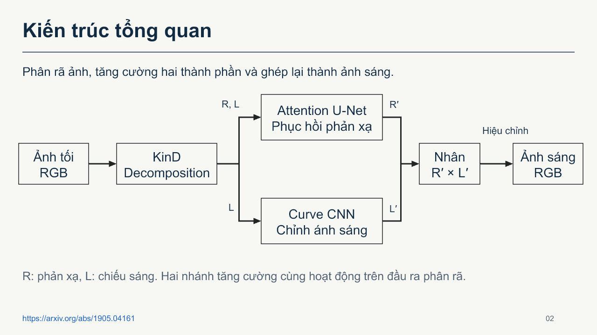

# Slide 02: Kiến trúc tổng quan

## Nội dung hiển thị

Phân rã ảnh, tăng cường hai thành phần và ghép lại thành ảnh sáng.

Ảnh tối
RGB

KinD
Decomposition

Attention U-Net
Phục hồi phản xạ

Curve CNN
Chỉnh ánh sáng

Nhân
R′ × L′

Ảnh sáng
RGB

R, L

L

R′

L′

Hiệu chỉnh

R: phản xạ, L: chiếu sáng. Hai nhánh tăng cường cùng hoạt động trên đầu ra phân rã.

## Lời thuyết trình và chi tiết kỹ thuật

Trên sơ đồ, ảnh tối được phân rã thành R và L. Attention U-Net phục hồi R, Curve CNN điều chỉnh L, rồi hai kết quả nhân lại và được hiệu chỉnh thành ảnh sáng.

Ảnh đầu vào I là RGB, có shape N×3×H×W. N là số ảnh trong batch, C là số kênh, H và W là chiều cao và chiều rộng. Với ảnh 600×400, tensor có kích thước 1×3×400×600. Nhánh phân rã tạo R ba kênh và L một kênh. R biểu diễn phản xạ, còn L biểu diễn chiếu sáng theo mô hình Retinex.

R và L cùng đi vào Attention U-Net để ước lượng R phẩy. Đồng thời, L đi vào Curve CNN để tạo L phẩy. Hai nhánh tăng cường xử lý song song về mặt cấu trúc; Curve CNN không nhận ảnh RGB sau U-Net làm đầu vào. Đầu ra mạng là R phẩy nhân L phẩy, trong đó L một kênh được broadcast trên ba kênh RGB.

Mô hình có 2.217.963 tham số và 52 tầng convolution hoặc transposed convolution. Ý tưởng tách phản xạ và chiếu sáng dựa trên KinD. Các cấu hình tầng cụ thể là triển khai hiện tại của dự án. Đầu ra mạng còn qua hậu xử lý trước khi lưu và tính chỉ số.

https://arxiv.org/abs/1905.04161

Đối chiếu mã và dữ liệu: E:/trenlop/XuLyAnh/Do_An_Tang_Cuong_Anh/kind_enhance/models/; E:/trenlop/XuLyAnh/Do_An_Tang_Cuong_Anh/configs/model.json; E:/trenlop/XuLyAnh/Do_An_Tang_Cuong_Anh/experiments/ag_refinement/run_four_metric_curriculum/test/metrics.json; E:/trenlop/XuLyAnh/Do_An_Tang_Cuong_Anh/reports/BAO_CAO_BAN_DA_CHOT_SO_VOI_AWF.md

D:/Ảnh/Ảnh Bài tập/ID175.pdf, trang 4–7 (tham khảo hình thức sơ đồ)

https://arxiv.org/abs/1905.04161
