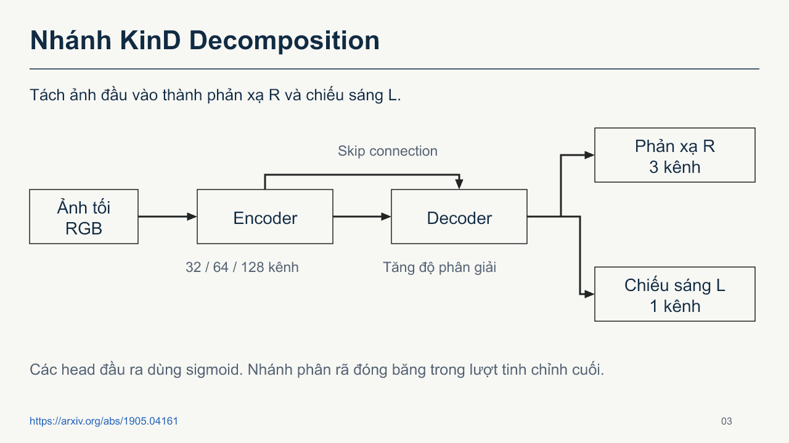

# Slide 03: Nhánh KinD Decomposition

## Nội dung hiển thị

Tách ảnh đầu vào thành phản xạ R và chiếu sáng L.

Ảnh tối
RGB

Encoder

Decoder

Phản xạ R
3 kênh

Chiếu sáng L
1 kênh

Skip connection

32 / 64 / 128 kênh

Tăng độ phân giải

Các head đầu ra dùng sigmoid. Nhánh phân rã đóng băng trong lượt tinh chỉnh cuối.

## Lời thuyết trình và chi tiết kỹ thuật

Sơ đồ rút gọn nhánh phân rã thành encoder và decoder với skip connection. Hai head cho R ba kênh và L một kênh. Chi tiết nhánh ánh sáng và từng convolution được giải thích trong phần ghi chú bên dưới.

Nhánh phân rã có encoder và decoder nhỏ. Conv đầu tiên biến ảnh ba kênh thành 32 kênh đặc trưng. Sau hai lần max pooling, số kênh tăng thành 64 và 128, còn chiều cao và chiều rộng giảm. Với ảnh 400×600, ba mức lần lượt là 32×400×600, 64×200×300 và 128×100×150.

Decoder dùng transposed convolution kernel 2, stride 2 để tăng kích thước. Ở mỗi mức, đặc trưng upsample được ghép với skip từ encoder rồi đưa qua convolution. Khi kích thước lẻ, tensor được cắt theo shape của skip trước khi concat, tránh lỗi lệch kích thước.

Head R dùng Conv1×1 từ 32 xuống ba kênh và sigmoid. Head L ghép 32 kênh đặc trưng ánh sáng từ mức đầu với 32 kênh decoded, rồi Conv1×1 tạo một kênh và sigmoid. Nhánh này có 235.876 tham số. Trong lượt tinh chỉnh cuối, nhóm đóng băng nhánh phân rã để tập trung học hai nhánh tăng cường.

https://arxiv.org/abs/1905.04161

Đối chiếu mã và dữ liệu: E:/trenlop/XuLyAnh/Do_An_Tang_Cuong_Anh/kind_enhance/models/; E:/trenlop/XuLyAnh/Do_An_Tang_Cuong_Anh/configs/model.json; E:/trenlop/XuLyAnh/Do_An_Tang_Cuong_Anh/experiments/ag_refinement/run_four_metric_curriculum/test/metrics.json; E:/trenlop/XuLyAnh/Do_An_Tang_Cuong_Anh/reports/BAO_CAO_BAN_DA_CHOT_SO_VOI_AWF.md

D:/Ảnh/Ảnh Bài tập/ID175.pdf, trang 4–7 (tham khảo hình thức sơ đồ)

https://arxiv.org/abs/1905.04161
