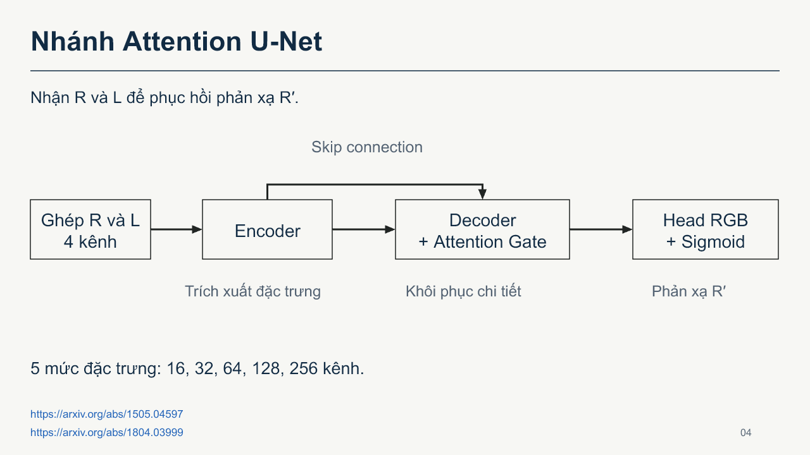

# Slide 04: Nhánh Attention U-Net

## Nội dung hiển thị

Nhận R và L để phục hồi phản xạ R′.

Ghép R và L
4 kênh

Encoder

Decoder
+ Attention Gate

Head RGB
+ Sigmoid

Skip connection

Trích xuất đặc trưng

Khôi phục chi tiết

Phản xạ R′

5 mức đặc trưng: 16, 32, 64, 128, 256 kênh.

## Lời thuyết trình và chi tiết kỹ thuật

Em đọc sơ đồ từ trái sang phải: ghép R và L, trích xuất đặc trưng bằng encoder, khôi phục bằng decoder có attention, rồi đưa qua head RGB và sigmoid. Đường phía trên là skip connection.

Attention U-Net phục hồi phản xạ. Đầu vào là concat R ba kênh với L một kênh, thành bốn kênh. Việc đưa thêm L cung cấp thông tin vùng đang thiếu sáng bên cạnh nội dung phản xạ. Đây là giải thích vai trò thiết kế, chưa phải kết quả ablation chứng minh riêng tác dụng của L.

Encoder có năm mức 16, 32, 64, 128 và 256 kênh. Mỗi mức gồm hai Conv3×3 đi cùng LeakyReLU. Bốn lần pooling tạo đặc trưng ở nhiều tỷ lệ. Với ảnh 400×600, các shape không gian lần lượt là 400×600, 200×300, 100×150, 50×75 và 25×38 vì pooling dùng ceil_mode.

Decoder đi ngược lại từ 256 về 16 kênh. Mỗi bước dùng transposed convolution, điều tiết skip bằng attention, concat rồi double convolution. Skip mang lại đặc trưng độ phân giải cao mà pooling đã làm giảm. Ý tưởng encoder–decoder và skip kế thừa U-Net, còn gate dựa trên Attention U-Net. Dự án áp dụng chúng cho hồi quy ảnh, trong khi bài gốc đánh giá trên phân đoạn y sinh.

https://arxiv.org/abs/1804.03999
https://arxiv.org/abs/1505.04597

Đối chiếu mã và dữ liệu: E:/trenlop/XuLyAnh/Do_An_Tang_Cuong_Anh/kind_enhance/models/; E:/trenlop/XuLyAnh/Do_An_Tang_Cuong_Anh/configs/model.json; E:/trenlop/XuLyAnh/Do_An_Tang_Cuong_Anh/experiments/ag_refinement/run_four_metric_curriculum/test/metrics.json; E:/trenlop/XuLyAnh/Do_An_Tang_Cuong_Anh/reports/BAO_CAO_BAN_DA_CHOT_SO_VOI_AWF.md

D:/Ảnh/Ảnh Bài tập/ID175.pdf, trang 4–7 (tham khảo hình thức sơ đồ)

https://arxiv.org/abs/1505.04597

https://arxiv.org/abs/1804.03999
