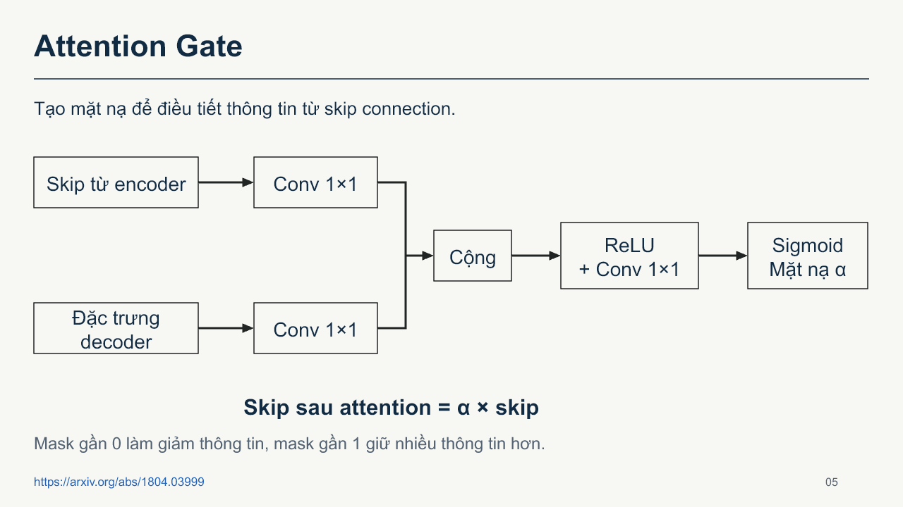

# Slide 05: Attention Gate

## Nội dung hiển thị

Tạo mặt nạ để điều tiết thông tin từ skip connection.

Skip từ encoder

Đặc trưng decoder

Conv 1×1

Conv 1×1

Cộng

ReLU
+ Conv 1×1

Sigmoid
Mặt nạ α

Skip sau attention = α × skip

Mask gần 0 làm giảm thông tin, mask gần 1 giữ nhiều thông tin hơn.

## Lời thuyết trình và chi tiết kỹ thuật

Hai nguồn thông tin cùng đi qua Conv 1×1, cộng lại rồi qua ReLU, Conv 1×1 và sigmoid để tạo mask. Mask nhân với skip trước khi ghép vào decoder.

Attention gate trong code là additive spatial attention. Có hai đầu vào: skip từ encoder và up từ decoder ở cùng độ phân giải. Hai Conv1×1 riêng chiếu chúng từ C kênh xuống C/2 kênh. Sau đó cộng hai tensor, đi qua ReLU, rồi một Conv1×1 khác đưa về một kênh. Sigmoid tạo mask alpha trong khoảng từ 0 đến 1.

Mask có shape N×1×H×W, được broadcast khi nhân với skip N×C×H×W. Như vậy mask điều tiết từng vị trí không gian. Skip đã điều tiết mới concat với up để phục hồi đặc trưng.

Điểm cần phân biệt là gate này không phải self-attention trong Transformer. Không có Q, K, V hoặc ma trận liên hệ mọi cặp pixel. Gate cũng không tự đảm bảo loại sạch nhiễu; đó là một cơ chế học phụ thuộc dữ liệu và loss. Ví dụ tại mức 128 kênh, hai projection tạo 64 kênh, score tạo một kênh, concat lại thành 256 kênh trước khi fuse về 128.

https://arxiv.org/abs/1804.03999

Đối chiếu mã và dữ liệu: E:/trenlop/XuLyAnh/Do_An_Tang_Cuong_Anh/kind_enhance/models/; E:/trenlop/XuLyAnh/Do_An_Tang_Cuong_Anh/configs/model.json; E:/trenlop/XuLyAnh/Do_An_Tang_Cuong_Anh/experiments/ag_refinement/run_four_metric_curriculum/test/metrics.json; E:/trenlop/XuLyAnh/Do_An_Tang_Cuong_Anh/reports/BAO_CAO_BAN_DA_CHOT_SO_VOI_AWF.md

D:/Ảnh/Ảnh Bài tập/ID175.pdf, trang 4–7 (tham khảo hình thức sơ đồ)

https://arxiv.org/abs/1804.03999
