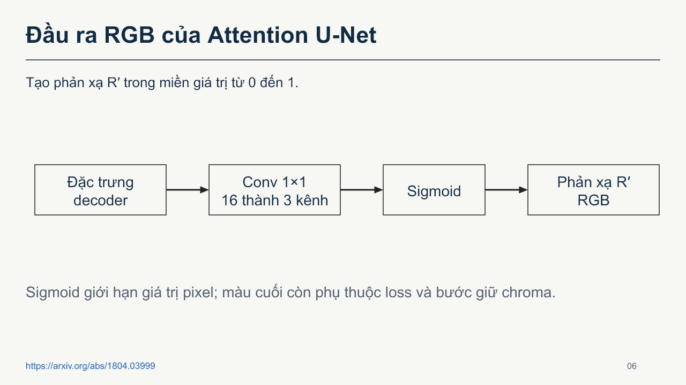

# Slide 06: Đầu ra RGB của Attention U-Net

## Nội dung hiển thị

Tạo phản xạ R′ trong miền giá trị từ 0 đến 1.

Đặc trưng
decoder

Conv 1×1
16 thành 3 kênh

Sigmoid

Phản xạ R′
RGB

Sigmoid giới hạn giá trị pixel; màu cuối còn phụ thuộc loss và bước giữ chroma.

## Lời thuyết trình và chi tiết kỹ thuật

Đặc trưng decoder đi qua Conv 1×1 để giảm từ 16 xuống ba kênh. Sigmoid tạo R phẩy có giá trị trong khoảng 0 đến 1.

Head cuối của Attention U-Net dùng Conv1×1 từ 16 xuống ba kênh rồi sigmoid để tạo R phẩy RGB. Sigmoid giới hạn từng giá trị trong khoảng từ 0 đến 1, phù hợp miền phản xạ mà mô hình dùng. Tuy nhiên giới hạn miền giá trị không có nghĩa là mô hình tự khôi phục đúng màu ảnh chuẩn.

Màu còn phụ thuộc mục tiêu huấn luyện và các bước sau mạng. Ở bản cấu hình đã chốt, bước giữ chroma dùng blend bằng 1. Vì vậy chroma cuối lấy từ input đã làm trơn, trong khi luminance chịu ảnh hưởng của đầu ra mạng. Em không diễn giải đầu ra RGB là bằng chứng toàn bộ màu đều do U-Net học ra.

Điều này cũng giải thích vì sao tăng độ sáng hoặc tăng gradient chưa đảm bảo màu giống GT. Muốn kết luận về màu phải đo riêng sai màu hoặc đánh giá với ảnh chuẩn, thay vì chỉ dựa vào MLI, CI, E và AG.

https://arxiv.org/abs/1804.03999

Đối chiếu mã và dữ liệu: E:/trenlop/XuLyAnh/Do_An_Tang_Cuong_Anh/kind_enhance/models/; E:/trenlop/XuLyAnh/Do_An_Tang_Cuong_Anh/configs/model.json; E:/trenlop/XuLyAnh/Do_An_Tang_Cuong_Anh/experiments/ag_refinement/run_four_metric_curriculum/test/metrics.json; E:/trenlop/XuLyAnh/Do_An_Tang_Cuong_Anh/reports/BAO_CAO_BAN_DA_CHOT_SO_VOI_AWF.md

D:/Ảnh/Ảnh Bài tập/ID175.pdf, trang 4–7 (tham khảo hình thức sơ đồ)

https://arxiv.org/abs/1804.03999
