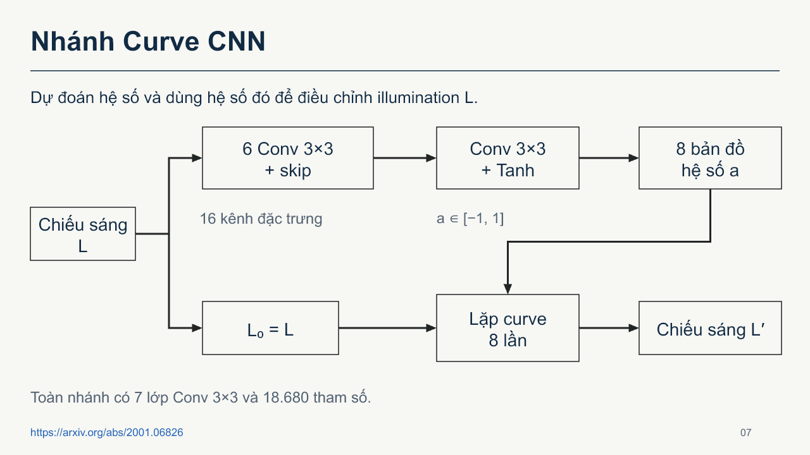

# Slide 07: Nhánh Curve CNN

## Nội dung hiển thị

Dự đoán hệ số và dùng hệ số đó để điều chỉnh illumination L.

Chiếu sáng L

6 Conv 3×3
+ skip

Conv 3×3
+ Tanh

8 bản đồ
hệ số a

L₀ = L

Lặp curve
8 lần

Chiếu sáng L′

16 kênh đặc trưng

a ∈ [−1, 1]

Toàn nhánh có 7 lớp Conv 3×3 và 18.680 tham số.

## Lời thuyết trình và chi tiết kỹ thuật

Từ L, nhánh trên dự đoán tám bản đồ hệ số qua CNN và tanh. Nhánh dưới giữ L làm giá trị khởi đầu rồi áp dụng tám bước curve theo các hệ số đó để tạo L phẩy. Sáu convolution nằm trong khối CNN, một convolution nằm ở head hệ số.

Curve CNN nhận L một kênh và dự đoán các hệ số điều chỉnh ánh sáng theo pixel. Mạng có bảy lớp Conv3×3 với padding 1 nên giữ nguyên kích thước không gian. Stem đưa một kênh thành 16 kênh. Ba convolution encoder giữ 16 kênh và lưu các đặc trưng trung gian. Hai convolution decoder ghép skip để có 32 kênh đầu vào, rồi đưa về 16 kênh.

Lớp cuối ghép với skip từ stem, nhận 32 kênh và tạo tám kênh hệ số. Tanh giới hạn mỗi hệ số trong khoảng âm một đến một. Cả nhánh có 18.680 tham số. Tám map này sẽ dùng cho tám bước biến đổi illumination, không phải tám ảnh đầu ra độc lập.

Dự án kế thừa công thức đường cong từ Zero-DCE nhưng có điều chỉnh rõ ràng. Zero-DCE gốc sử dụng curve trên RGB và học không cần ảnh tham chiếu. Nhánh hiện tại tác động lên L một kênh và học cùng ảnh GT thông qua loss của mô hình ghép. Vì vậy em gọi đây là Curve CNN dựa trên ý tưởng Zero-DCE.

https://arxiv.org/abs/2001.06826

Đối chiếu mã và dữ liệu: E:/trenlop/XuLyAnh/Do_An_Tang_Cuong_Anh/kind_enhance/models/; E:/trenlop/XuLyAnh/Do_An_Tang_Cuong_Anh/configs/model.json; E:/trenlop/XuLyAnh/Do_An_Tang_Cuong_Anh/experiments/ag_refinement/run_four_metric_curriculum/test/metrics.json; E:/trenlop/XuLyAnh/Do_An_Tang_Cuong_Anh/reports/BAO_CAO_BAN_DA_CHOT_SO_VOI_AWF.md

D:/Ảnh/Ảnh Bài tập/ID175.pdf, trang 4–7 (tham khảo hình thức sơ đồ)

https://arxiv.org/abs/2001.06826
