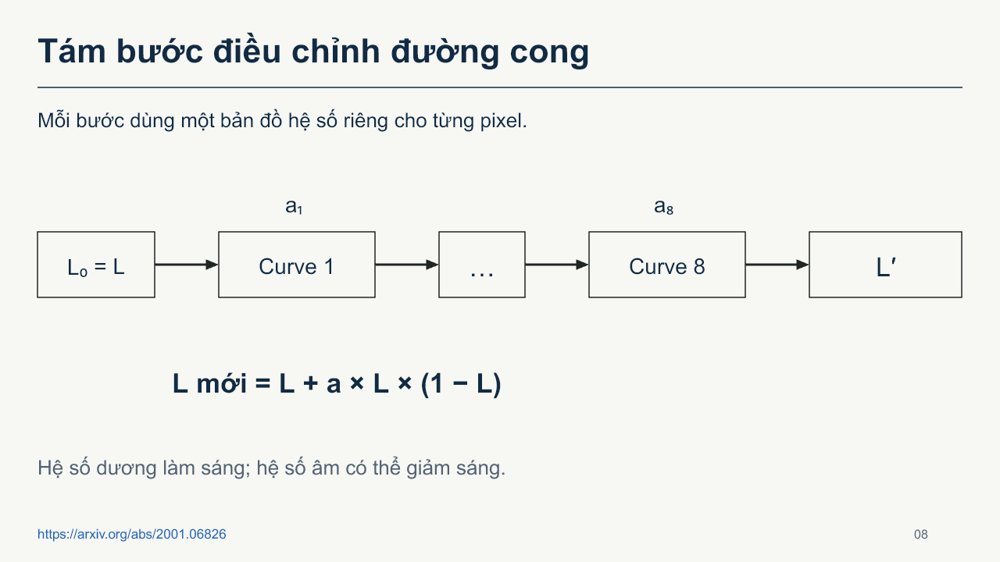

# Slide 08: Tám bước điều chỉnh đường cong

## Nội dung hiển thị

Mỗi bước dùng một bản đồ hệ số riêng cho từng pixel.

L₀ = L

Curve 1

…

Curve 8

L′

a₁

a₈

L mới = L + a × L × (1 − L)

Hệ số dương làm sáng; hệ số âm có thể giảm sáng.

## Lời thuyết trình và chi tiết kỹ thuật

Mỗi bước curve nhận illumination hiện tại và một hệ số theo pixel. Sau tám bước, em nhận L phẩy để ghép với R phẩy. Công thức duy nhất ở giữa slide mô tả phép cập nhật này.

Sau khi có tám bản đồ hệ số, illumination được cập nhật tám lần theo công thức L tiếp theo bằng L hiện tại cộng a nhân L nhân một trừ L. Nếu hệ số a dương, phép biến đổi làm sáng các giá trị trung gian. Nếu a âm, nó có thể giảm sáng. Mức biến đổi phụ thuộc cả hệ số lẫn giá trị pixel.

Do hệ số phụ thuộc vị trí, vùng tối và vùng sáng có thể nhận cách điều chỉnh khác nhau. Các hệ số được CNN dự đoán một lần rồi dùng lần lượt trong vòng lặp. Đầu ra L phẩy sau tám bước mới nhân với R phẩy.

Khi coi a là cố định, đạo hàm theo L là 1+a(1−2L), không âm trong miền đã nêu. Đây là tính chất của phép curve. Với toàn mạng, a lại phụ thuộc vào L nên đạo hàm tổng còn đi qua mạng dự đoán hệ số. Em phân biệt hai trường hợp này để tránh kết luận quá rộng rằng toàn bộ CNN là một ánh xạ đơn điệu. Tất cả các phép cập nhật đều cho phép Autograd tính gradient.

https://arxiv.org/abs/2001.06826

Đối chiếu mã và dữ liệu: E:/trenlop/XuLyAnh/Do_An_Tang_Cuong_Anh/kind_enhance/models/; E:/trenlop/XuLyAnh/Do_An_Tang_Cuong_Anh/configs/model.json; E:/trenlop/XuLyAnh/Do_An_Tang_Cuong_Anh/experiments/ag_refinement/run_four_metric_curriculum/test/metrics.json; E:/trenlop/XuLyAnh/Do_An_Tang_Cuong_Anh/reports/BAO_CAO_BAN_DA_CHOT_SO_VOI_AWF.md

D:/Ảnh/Ảnh Bài tập/ID175.pdf, trang 4–7 (tham khảo hình thức sơ đồ)

https://arxiv.org/abs/2001.06826
