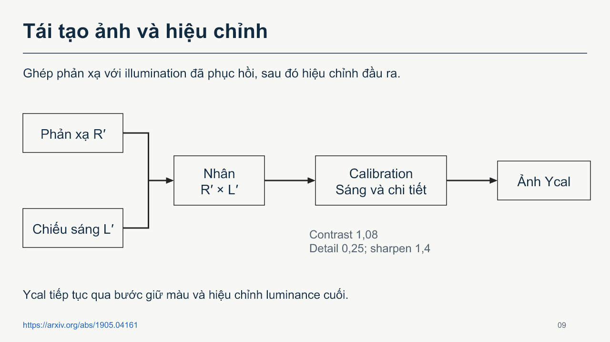

# Slide 09: Tái tạo ảnh và hiệu chỉnh

## Nội dung hiển thị

Ghép phản xạ với illumination đã phục hồi, sau đó hiệu chỉnh đầu ra.

Phản xạ R′

Chiếu sáng L′

Nhân
R′ × L′

Calibration
Sáng và chi tiết

Ảnh Ycal

Contrast 1,08
Detail 0,25; sharpen 1,4

Ycal tiếp tục qua bước giữ màu và hiệu chỉnh luminance cuối.

## Lời thuyết trình và chi tiết kỹ thuật

Hai thành phần đã tăng cường được nhân để tái tạo RGB. Calibration hiệu chỉnh độ sáng và chi tiết, tạo Ycal trước khi qua bước giữ màu.

Đầu ra trực tiếp của mạng là Yraw bằng R phẩy nhân L phẩy. Nhưng ảnh được lưu và chấm điểm trong dự án là ảnh sau hậu xử lý. Calibration cộng thêm ba thành phần vào Yraw: đặc trưng tương phản, chi tiết từ ảnh đầu vào và thành phần sharpen. Hệ số lần lượt là 0,08; 0,25 và 1,4 theo cấu hình đã duyệt.

Đặc trưng tương phản lấy luminance trừ mean không gian. Thành phần detail dùng input nâng lũy thừa 0,4 và các bộ lọc trung bình, có ngưỡng để chặn biên độ. Thành phần sharpen dựa vào phần chênh giữa prediction và ảnh blur, có trọng số theo gradient. Cuối bước có clamp về khoảng hợp lệ.

Các hệ số này không phải trọng số của một CNN bổ sung. Đây là hiệu chỉnh được dự án triển khai. Khi báo cáo kết quả, cần nói rõ số đo là của toàn pipeline, vì chỉ chạy ba mạng rồi dừng ở Yraw sẽ chưa tái tạo đúng ảnh cuối đã công bố.

Đối chiếu mã và dữ liệu: E:/trenlop/XuLyAnh/Do_An_Tang_Cuong_Anh/kind_enhance/models/; E:/trenlop/XuLyAnh/Do_An_Tang_Cuong_Anh/configs/model.json; E:/trenlop/XuLyAnh/Do_An_Tang_Cuong_Anh/experiments/ag_refinement/run_four_metric_curriculum/test/metrics.json; E:/trenlop/XuLyAnh/Do_An_Tang_Cuong_Anh/reports/BAO_CAO_BAN_DA_CHOT_SO_VOI_AWF.md

D:/Ảnh/Ảnh Bài tập/ID175.pdf, trang 4–7 (tham khảo hình thức sơ đồ)

https://arxiv.org/abs/1905.04161
