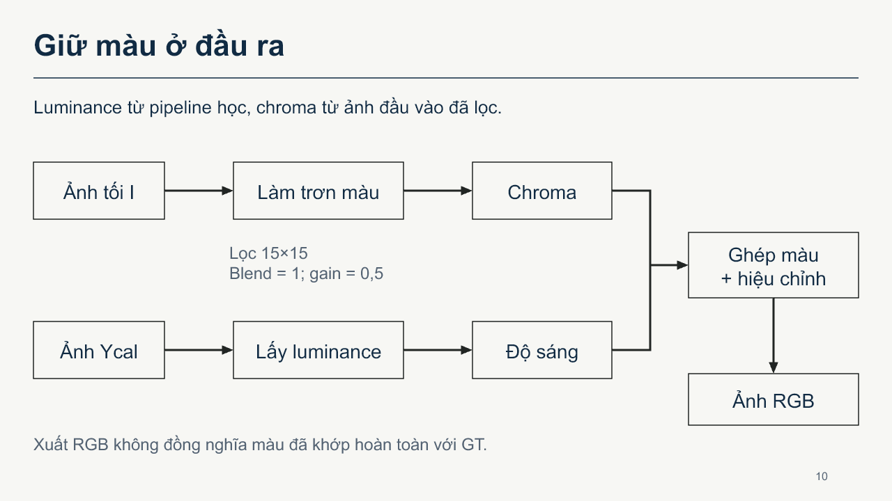

# Slide 10: Giữ màu ở đầu ra

## Nội dung hiển thị

Luminance từ pipeline học, chroma từ ảnh đầu vào đã lọc.

Ảnh tối I

Làm trơn màu

Chroma

Ảnh Ycal

Lấy luminance

Độ sáng

Ghép màu
+ hiệu chỉnh

Ảnh RGB

Lọc 15×15
Blend = 1; gain = 0,5

Xuất RGB không đồng nghĩa màu đã khớp hoàn toàn với GT.

## Lời thuyết trình và chi tiết kỹ thuật

Hai dòng trên sơ đồ mang hai loại thông tin: input đã làm trơn cung cấp chroma, còn Ycal cung cấp luminance. Chúng được ghép và chặn gamut để xuất RGB.

Bước giữ màu bắt đầu từ luminance y của ảnh đã calibration. Input được làm trơn bằng average pooling ngang và dọc với kernel 15, nhằm lấy thông tin màu ít dao động hơn. Chroma nguồn là độ lệch RGB so với luminance của input đã lọc, được chuẩn hóa rồi nhân với luminance đầu ra và gain 0,5.

Ở cấu hình blend bằng 1, chroma nguồn thay phần chroma của prediction. Code còn trừ luminance còn dư trong chroma và co biên độ theo gamut để RGB nằm trong khoảng hợp lệ. Sau đó luminance được tăng contrast 1,02 quanh mean và lift 0,007, đồng thời tiếp tục giữ hướng chroma.

Ý nghĩa là tách điều chỉnh mức sáng khỏi hướng màu. Dù vậy màu vẫn có thể lệch GT, vì input tối đã chứa nhiễu hoặc thiếu thông tin màu. Các bước này giữ nguyên scalar trong bản triển khai; chúng không thay đổi kiến trúc ba nhánh.

Đối chiếu mã và dữ liệu: E:/trenlop/XuLyAnh/Do_An_Tang_Cuong_Anh/kind_enhance/models/; E:/trenlop/XuLyAnh/Do_An_Tang_Cuong_Anh/configs/model.json; E:/trenlop/XuLyAnh/Do_An_Tang_Cuong_Anh/experiments/ag_refinement/run_four_metric_curriculum/test/metrics.json; E:/trenlop/XuLyAnh/Do_An_Tang_Cuong_Anh/reports/BAO_CAO_BAN_DA_CHOT_SO_VOI_AWF.md

D:/Ảnh/Ảnh Bài tập/ID175.pdf, trang 4–7 (tham khảo hình thức sơ đồ)

